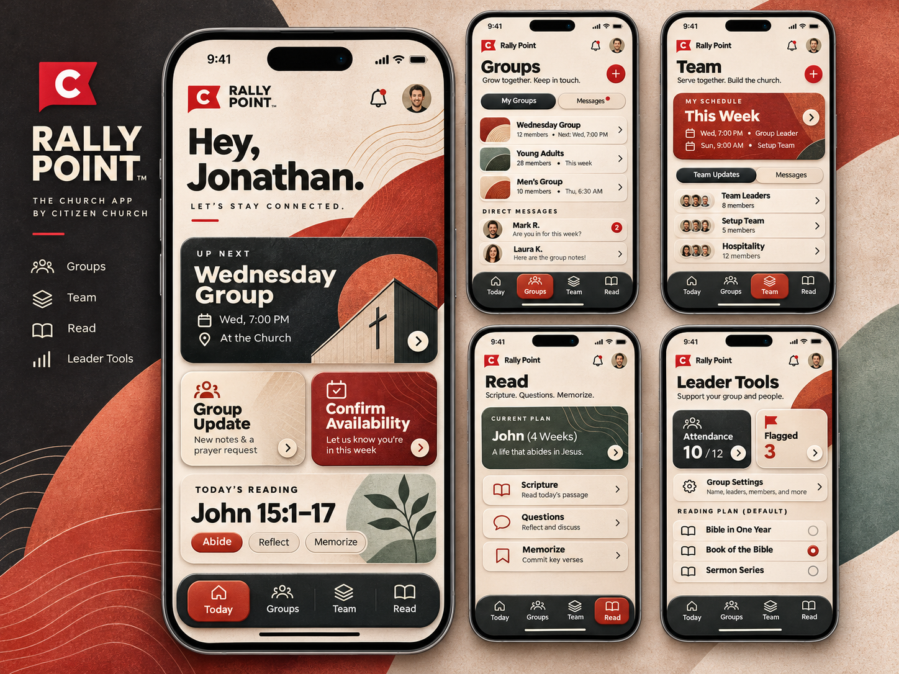
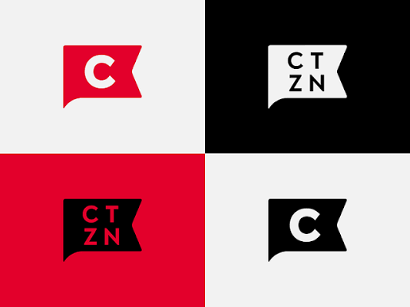

# RALLY POINT
## Master Blueprint — Version 1.0

**A connected, welcoming church experience by Citizen Church**  
**Baseline date:** November 19, 2026  
**Status:** Working product + design baseline for prototype development; not a final implementation contract  
**Working name:** Rally Point (subject to church approval)  
**Primary platform:** Mobile-first app experience  
**Source of truth:** This file, the image references in `docs/assets/`, `docs/COMPANION_ARCHITECTURE_DECISION.md` (D-10), and `docs/PALETTE_V2_COLOR_ONLY.md` (D-11, November 20, 2026)

> **North star:** Opening Rally Point should feel like walking into a place where people are genuinely glad you're there. The interface helps people know what matters today, connect with their community, serve, and grow.

**The non-negotiable collaboration rule:** Preserve previously approved structure and visual decisions unless a change request explicitly names what should change. *Improve the existing design; do not reinvent it during routine implementation.*

---

## 1. Executive product definition

**Rally Point is a proposed Citizen Church digital community experience**, bringing personalized daily information and three core participation areas into one coherent mobile product.

- **Today:** What matters to me right now? A role-aware personal front door—not a fourth independent content program.
- **Groups:** Who am I connecting with? Group communications, 1:1 messaging, and permitted leader coordination.
- **Team:** Where am I serving? Team communications, personal schedule, and permitted leader coordination.
- **Read:** How am I growing? Scripture, questions, memorization, and leader-selected reading-plan defaults.

**Intended emotional hierarchy:** (1) connected and welcomed, (2) energetic and engaging, (3) clear and purposeful.  
**Working positioning:** *Your people. Your purpose. Your next step.* (proposed copy; not a locked tagline.)

### Product is / product is not

| Rally Point should be | Rally Point should not be |
|---|---|
| A personal entrance into community life | A generic church bulletin pasted into an app |
| A clear place to act on relevant information | A noisy feed of every possible update |
| One coherent experience across member and leader needs | Two unrelated member and leader applications |
| A visually confident, recognizable product | A default card grid with an attractive color scheme |
| A mobile-first workflow with honest demo states | A decorative mockup suggesting unfinished features work |

## 2. Confirmed requirements versus proposals

This distinction prevents inferred ideas from quietly becoming mandatory features.

| Source / confidence | Decision or requirement |
|---|---|
| **Meeting whiteboard + user explanation — confirmed** | Three main capability areas: Groups, Team, Read; member and leader needs for each. |
| **Subsequent product direction — confirmed** | A fourth, first-position **Today** tab aggregating immediate calendar/schedule information, relevant notifications, and actionable tasks. |
| **Subsequent product direction — confirmed** | Four primary tabs: **Today, Groups, Team, Read**. Leader capabilities should be visible based on permissions rather than requiring a separate universal app. |
| **Design feedback — confirmed direction** | Warm Editorial visual style with high contrast, strong borders, expressive components, and substantially less plain white than early concepts. |
| **Design feedback — confirmed direction** | Incorporate Citizen Church logo assets. Avoid generic stock/background photography; use graphic-led treatments instead. |
| **Working recommendations — proposed** | Role-based Today prioritization, a contextual leader-tools entry, and a dedicated content hierarchy for all four tabs. |
| **Future/undecided** | Exact attendance definition; flagging workflow; reading-plan administration scope; notification policy; integrations; full production authentication and privacy model. |

**Important:** Example names, dates, sample messages, reading passages, event locations, attendance counts, and avatar imagery in mockups are **illustrative**. They are not real operational data or guaranteed integrations.

## 3. Users, permissions, and information architecture

### 3.1 User modes

**Member** can access the member-facing capabilities for the areas in which they participate. **Leader** is not a mutually exclusive user type: a leader remains a member and gains additional tools only for groups/teams or reading content they are authorized to manage.

**Design principle:** Do not create a permanent fifth bottom tab for leader tools. Show contextual leadership actions on Today and/or inside Groups, Team, and Read as appropriate. A separate leader-tools subview is acceptable if linked contextually.

### 3.2 Four-tab navigation

```text
RALLY POINT
├── TODAY          personalized snapshot + deep links
├── GROUPS         group conversations + 1:1 messages
│   └── Leader: attendance, flagging (authorized contexts)
├── TEAM           communications + My Schedule
│   └── Leader: attendance, flagging (authorized contexts)
└── READ           Scripture + Questions + Memorize
    └── Leader: select/configure default reading path
```

### 3.3 Member / leader capability matrix

| Area | Member view | Additional authorized leader view |
|---|---|---|
| **Today** | Next relevant schedule item, actionable requests, important messages, today's reading | Priority reminders and links for applicable attendance or follow-up work |
| **Groups** | Group communication and 1:1 communication | Attendance and flagging people who may need follow-up / are not accounted for |
| **Team** | Team communication and “My Schedule” | Attendance and flagging for applicable team/volunteer context |
| **Read** | Scripture, questions, memorization | Choose the default approach: Bible in One Year, study a Bible book, or follow a sermon series |

**Boundary:** The meeting's “attendance” language and “flagging” intent require policy clarification. This blueprint intentionally does **not** assume universal location tracking, automated attendance enforcement, clinical/safety risk labels, or that a missing person should automatically be marked concerning.

## 4. Experience requirements by tab

### 4.1 Today — personalized front door

**Job to be done:** “Show me what's next, what needs my response, and how to stay connected today—without making me sort through the whole app.”

**Recommended information order (dynamic by relevance, not fixed decoration):**

1. **Welcome/identity:** compact branded greeting with notification affordance, not an enormous banner that crowds out useful content.
2. **Up next:** the next meaningful upcoming gathering, serving commitment, or other relevant calendar item, with time and a clear link to its source.
3. **Needs your attention:** a small number of actionable items such as respond to a schedule request or read a new group message.
4. **Today's reading:** reading title/passage plus a direct route to Read; reflection/memorization actions if configured.
5. **Leader follow-up (conditional):** only when the person has permission and an actual actionable leader item exists.

**Interaction rules**

- Every Today item opens its originating destination: schedule → Team; group conversation → Groups; reading → Read; attendance/follow-up → authorized leader view.
- Never duplicate an entire message thread, schedule, or reading workflow on Today.
- Rank actionable and time-sensitive content above promotional or purely informational content.
- Show friendly empty states: “You're all caught up” instead of manufacturing alerts.
- Do not show synthetic progress scores, percentages, or counts solely for decoration.
- A user with no group/team still has a meaningful Today screen and clear paths to discover how to participate (discovery details remain future scope).

### 4.2 Groups — belonging and communication

**Member baseline**

- View groups the user belongs to.
- Open a group conversation and read/send messages.
- Initiate or access permitted 1:1 messages (recipient/discovery and communication rules to be defined).
- Recognize who is in a conversation through authentic names/avatars where consented and available.

**Leader additions**

- View relevant attendance records or attendance-taking tasks for groups they manage.
- Record or update attendance per agreed rules (attendance subject and cadence TBD).
- Flag a person or unresolved absence for follow-up using a defined, permission-controlled workflow.

**Not yet approved:** automated escalation, individual welfare assumptions, push notifications to the entire group, and unbounded message access by leaders.

### 4.3 Team — serving and scheduling

**Member baseline**

- View the teams the person serves with.
- Read/send team communications.
- Open **My Schedule** to see upcoming serving commitments and their current state.
- Respond to an availability/confirmation request if the scheduling integration or native scheduling workflow supports it.

**Leader additions**

- Attendance/check-in records for the specific team and date the leader manages.
- Identify unaccounted-for people and flag them for appropriate follow-up under agreed church policy.

**Not yet approved:** automatic staffing assignments, self-scheduling, swaps, calendar sync, or replacing an existing church scheduling system. These are discovery topics, not implicit v1.0 requirements.

### 4.4 Read — Scripture, questions, memorize

**Member baseline**

- Read the daily or assigned Scripture selection.
- View questions connected to that content.
- Access a memorization component (exact method and any progress persistence TBD).

**Leader configuration paths** (as described in the meeting)

1. **Bible in One Year** — daily reading from a structured full-Bible plan.
2. **Book of the Bible** — focused progression through one selected biblical book.
3. **Sermon Series** — reading content connected to a designated sermon series.

**Open policy decisions:** Is the default set church-wide, per group, or for each individual? Can a member override the default? Who provides/owns Scripture text and questions? How is an active plan changed without losing progress? Nothing in the meeting yet settles these questions.

## 5. Visual identity — Warm Editorial v1.0

**Reference status:** The approved direction is the latest high-contrast, textured, warmer multi-screen concept—not a promise that every rendered pixel, photographic crop, sample label, or icon is approved.



**Citizen Church logo reference:** Use authentic provided logo shapes rather than inventing a replacement flag/C icon. Treat the Rally Point wordmark lockup in the mockup as exploratory.



### 5.1 Design character

- **Connected and welcomed first:** human, personal, warm, invitational.
- **Energetic second:** confident layout, contrast, and strong visual rhythm, not noisy motion.
- **Purposeful third:** next actions are instantly recognizable.
- **Warm Editorial:** premium, tactile, designed, highly legible; a distinctive product rather than a template.

### 5.2 Palette v2 — color-only refinement (D-11, November 20, 2026)

**Approved correction:** Remove orange/terracotta/rust *accents* only. Retain the approved current app composition, warm textured nonwhite cream background, dark charcoal navigation, vivid Citizen red, defined borders, shadows, typography, imagery geometry, icons and layout. **Absolutely no whitewashing or generic redesign.** `docs/PALETTE_V2_COLOR_ONLY.md` is the binding detailed change specification, selector audit and acceptance test. Existing warm parchment/beige neutrals are not orange accents and should remain.

These values serve as a usable starting system. **Only the Citizen red is sampled from the uploaded logo image; verify against original official brand assets before production.** Supporting colors are proposals informed by the approved visual direction, not official Citizen Church brand colors.

| Token | Suggested hex | Usage |
|---|---|---|
| `brand.citizenRed` | `#E3002B` | Identity, active tab, strongest calls to action; sampled from supplied logo |
| `ink.charcoal` | `#242322` | Navigation, important sections, high-contrast surfaces |
| `surface.cream` | `#F3E5D6` | Main warm canvas; avoid flat pure white everywhere |
| `surface.parchment` | `#E9D5C1` | Secondary cards/surfaces |
| `surface.pale` | `#FCF7F0` | Limited light surfaces where clarity is needed |
| `accent.terracotta` | **Retired / prohibited for accent use** | Replace only orange/rust/terracotta accent colors with existing Citizen red or charcoal, depending on surface size and contrast. Keep original graphic and component geometry. |
| `accent.sage` | `#5E7065` | Selective counterbalance, especially reading/community treatments |
| `line.defined` | `#C5AA94` | Noticeable borders against cream surfaces |
| `text.muted` | `#665E56` | Secondary metadata with accessible contrast checks |

**Color usage (D-11):** Keep cream as the broad **nonwhite textured canvas**, charcoal as the structural counterweight, real Citizen red as selective emphasis, and the existing sparing sage where currently used. **Orange/terracotta/rust accents are removed.** Large former orange panels usually become charcoal; small orange highlights may use Citizen red. Do not desaturate the entire UI, replace warm neutrals with white/gray, change borders/texture, or flatten existing cards. Resist both “all white cards” and “red everywhere.” Dark cards should have a clear purpose.

### 5.3 Component language

| Component | Visual rule |
|---|---|
| **Bottom navigation** | Four tabs only. Strong charcoal rail with expressive active-state treatment; distinct active indicator and clear text labels. Safe-area aware. |
| **Information surfaces** | Varied scale and proportion. Matte texture or subtle graphic motifs permitted; no generic stock hero photos. Borders should remain clearly discernible on warm backgrounds. |
| **Cards** | Use hierarchy instead of repeating identical rectangles. Primary event may be a large feature panel; secondary items compact and structured. |
| **Typography** | Confident oversized display headlines used selectively; readable body text. Candidate pair: Space Grotesk/Manrope for display + Inter for body (final font selection pending licensing/testing). |
| **Icons** | One coherent stroke family, typically 20–24 px; visible weights and enough contrast. Avoid mixed icon packs or decorative icon spam. |
| **People** | Authentic participant avatars only when authorized; otherwise initials/abstract placeholders. No invented real people. |
| **Graphic treatments** | Brand-derived geometry, fine contour/line motifs, tactile matte surfaces, restrained asymmetric compositions. |
| **Buttons** | High-contrast, clearly tappable, distinct from decorative pills, with focus/pressed/disabled states. |
| **Motion** | Light transitions and feedback serving orientation; support reduced motion; avoid theatrical animation. |

### 5.4 Layout rules

- **Mobile-first reference viewport:** 390 × 844 CSS px baseline; validate smaller and larger phone sizes.
- **Spacing foundation:** 8 px rhythm with 4 px for fine adjustment.
- **Proposed corner radii:** 12 / 18 / 24 px, varied intentionally (not everywhere the same).
- **Typical touch targets:** at least 44 × 44 CSS px.
- **Borders:** visible 1–1.5 px minimum where light surfaces meet; adjust by actual contrast and device rendering.
- **Accessibility target:** WCAG AA for text and interactive controls; do not sacrifice usability for a picture-perfect mockup.
- **Density:** above the fold should reveal meaningful information, not just a huge greeting or decorative cover.

### 5.5 Explicit anti-patterns

Do **not** reintroduce these while “polishing” the app:

- Generic white-on-white SaaS grids; four equal cards with tiny line icons.
- Unnecessary stock photos of mountains, people, Bible pages, or generic church buildings.
- Gratuitous dashboards: fake percentages, streaks, sales-style charts, arbitrary KPI rings.
- Glossy/metallic/glowing reds, deep burgundy gradients, excessive drop shadows.
- Cartoon illustrations, floating 3D blobs, random icons, or ornate AI-like decorations.
- New logos that replace or mutate the supplied Citizen Church identity without approval.
- A disconnected Leader fifth tab or separate visual system for the leader interface.

## 6. Initial screen composition guidance

### 6.1 Today (first build target)

**Hero/identity zone:** Citizen icon + Rally Point label, compact avatar/notification controls, clear greeting.  
**Primary experience zone:** one prominent “Up next” event, rich with information and a strong destination affordance.  
**Action zone:** two to three relevant next steps displayed in varied but coherent surfaces.  
**Reflection zone:** compact daily reading preview with one clear read action.  
**Persistent navigation:** Today / Groups / Team / Read with safe-area spacing.

**Illustrative fixture** (never present as live church data): Wednesday Group, a Sunday serving confirmation, one group message, and John 15:1–17 reading.

### 6.2 Groups

Groups list and recent messages, short previews, direct messaging entry, contextual group leader tools. Use space and contrast to emphasize real relationships, not manufactured gamification.

### 6.3 Team

My Schedule should be unmistakable, with upcoming assignments and state (e.g., pending/confirmed only if data supports those statuses), team chat, and conditional leader check-in tools.

### 6.4 Read

The Scripture experience should be more editorial and calm than the action-oriented Team screen. Maintain the brand system; offer distinct Scripture / Questions / Memorize flows. Leader default-plan selection must have explicit save/confirmation and scope labels when developed.

## 7. Data, integrations, and technical boundaries

### 7.1 Suggested conceptual entities (not a finalized database schema)

`User`, `Membership`, `Group`, `GroupConversation`, `DirectConversation`, `Team`, `ServingAssignment`, `ScheduleResponse`, `AttendanceRecord`, `FollowUpFlag`, `ReadingPlan`, `ReadingSelection`, `ReadingQuestion`, `MemoryPassage`, `Notification`, `RoleGrant`.

Each action should have a clear **source of record**. Today is a presentation/aggregation layer, not a second canonical store for schedule, messages, or reading.

### 7.2 Companion architecture decision (D-10, November 20, 2026)

**Locked product direction:** Rally Point is a distinct member-experience companion to existing church systems, **not** a replacement church-management system. Preserve the four-tab Warm Editorial design. Planning Center / Church Center is the primary candidate system of record for existing groups, schedules, and attendance **only where the church confirms product usage, grants authorization, and an official integration path has been verified**. Rally Point owns the personalized Today presentation layer and its differentiated Read experience. Prefer verified link-outs when supported API functionality is unavailable; do not replicate operational databases by default.

**Integration feasibility and governance:** See `docs/COMPANION_ARCHITECTURE_DECISION.md` for the reuse/enhance/build matrix, data ownership, authentication, privacy/minor safeguarding, proposed integration discovery, and explicit non-goals. **No live access or integration is yet authorized.** No claim is made that Church Center chats, 1:1 messages, scheduling responses, or notification data can be read/written via the public API.

### 7.3 Security and trust requirements before real users

- Role-and-context-aware permissions on every leader action; never rely solely on hiding UI controls.
- Protected 1:1 messages with clear recipient authorization and age/minor safeguards as applicable.
- Attendance/flags are sensitive church operational data: define access, visibility, retention, and audit logs before launch.
- A flag must have a documented meaning, owner, disposition, and resolution mechanism; avoid stigmatizing labels.
- Secure login/session handling, notification privacy, minimal personal data, appropriate consent.
- Scripture content licensing/permissions and accessibility before publication.
- No “production-ready” claims from visually functional prototypes.

## 8. Delivery roadmap and definition of done

### Phase 0 — Foundation lock **(now)**

**Output:** this blueprint, the visual reference, logo reference, a decision log, and a clearly scoped first build.  
**Exit:** Product, design, and initial scope are unambiguous enough to implement Today without redesigning the app.

### Phase 1 — Today UI fidelity prototype **(next build)**

**Goal:** One polished and working mobile Today screen in the existing application, built with reusable components and **explicitly labeled fixture data**.

**Build:** Brand shell/header; warm editorial design tokens; four-tab bottom navigation; Today hero; Up Next; actionable items; Read preview; empty and populated states; conditional sample leader action; responsive mobile behavior. Other tabs may have clearly marked placeholders until their own phase.

**Exit criteria:**

1. Visually faithful to approved warm-editorial reference in **hierarchy, contrast, borders, typography, spacing, and shape**, not merely colors.
2. Today has meaningful visible content within the first viewport; no giant empty white region.
3. Each tappable item navigates to its intended destination or to an honest, labeled demo placeholder—no dead controls presented as functional.
4. Four-tab navigation works in the preview; no fifth main tab.
5. All displayed church activity is clearly fixture/demo content until integrated.
6. Viewports ~320–430 CSS px remain usable; safe-area and tap targets are reasonable; key contrast verified.
7. Existing stable app behavior is preserved or intentionally scoped out in a documented change.
8. Build passes available checks and a preview deployment is reviewed on a phone.
9. No automatic merge to main or production deployment without explicit approval.

### Phase 2 — Complete member tab experiences

**Groups:** groups list/conversation/1:1 demo workflows.  
**Team:** team communication and My Schedule demo workflows.  
**Read:** Scripture, questions, memorize, reading-plan presentation.  
**Exit:** The four primary destinations feel cohesive and the main navigational journeys can be demoed end-to-end with fixtures.

### Phase 3 — Leader workflows and role logic

Add context-specific attendance, follow-up flags, reading defaults, role-aware Today alerts, and audit-aware state management *after* policy definitions are agreed.

### Integration discovery gate — after visual review, before production connector development

Validate Planning Center module usage, authorized access, endpoint-level feasibility, and exact workflows with church leadership. Inventory opportunities for safe deep links and determine the smallest read-only pilot. Do not request or store credentials until approval. See `docs/COMPANION_ARCHITECTURE_DECISION.md`.

### Phase 4 — Production integration and pilot

Choose source systems, implement authentication/integration, establish data protection, test actual user journeys, pilot with a limited authorized group, and then consider launch.

### Later / Phase 2 from whiteboard (separate horizon)

The meeting whiteboard referenced **Giving** and additional ministry/leadership organization as a later phase. These remain **out of first-build scope**; exact timing and features require clarification.

## 9. One-track development and change control

**Repository working reference:** Earlier project conversations identified `woodrow5087-hue/Citizen-groups`; verify that this remains the intended repository before a write/deploy.  
**Branching:** Work from current main into a clearly named preview branch; do not replace production by assumption.  
**One issue at a time:** New requests name the screen/component, desired change, and what must not change.  
**Comparison:** Review implementation next to the approved visual reference at matching mobile dimensions.  
**Approval:** Accept/reject specific changes, record the outcome here, then proceed.  
**Design debt:** If a decision is unresolved, track it openly instead of letting Codex invent product policy.

**Change request template**

```text
Rally Point change request
Screen / component:
Goal:
Exact change:
Must preserve:
References:
How we will know it worked:
Preview only; do not merge or deploy production without approval.
```

## 10. Open decisions (intentionally not invented)

| Priority | Question | Why it matters |
|---|---|---|
| **High** | Who takes attendance in Groups, and are these group members, volunteers, or both? | Correct workflow and privacy boundaries |
| **High** | What exactly does “flagging” mean, who receives it, and how is it resolved? | Safety, human follow-up, permissions |
| **High** | Does Team schedule come from an existing system? Which one? | Avoid duplicate scheduling/data conflicts |
| **High** | Who selects Read's default plan—church admin, group leader, or other leader? Can members override it? | Permissions and content behavior |
| **High** | Which user accounts, age groups, and messaging guardrails are in scope for an initial pilot? | Authentication and safeguarding |
| **Medium** | What should notification urgency and frequency be? | Attention without notification fatigue |
| **Medium** | Should an event calendar show only group/team events or church-wide events too? | Today and schedule model |
| **Medium** | Are authentic event or community photos available and approved for use? | Optional future art direction |
| **Medium** | What precisely belongs to the later Giving/Ministry phase? | Scope protection |
| **Low** | Is “Rally Point” the final public name, and how should it coexist with “Citizen Connect”? | Brand approval and app-store positioning |

**None of these open decisions blocks a fixture-based, non-production Today prototype.**

## 11. Decision register (v1.0)

| ID | Decision | Status |
|---|---|---|
| D-01 | Keep working name Rally Point | Working |
| D-02 | Connected and welcomed as primary emotion | Locked direction |
| D-03 | Four tabs in order: Today, Groups, Team, Read | Locked structure |
| D-04 | Leaders gain contextual capabilities; no mandatory fifth main tab | Locked structure |
| D-05 | Warm Editorial, high-contrast, tactile, graphic-led art direction | Locked direction |
| D-06 | Use authentic Citizen logo assets; avoid stock backgrounds | Locked direction |
| D-07 | Today first; fixture-based high-fidelity build before real integrations | Approved plan |
| D-08 | Flagging, attendance definitions, reading-control scope | Open requirements |
| D-09 | Giving and broader ministry functions deferred | Deferred |
| D-10 | Build Rally Point as a distinct companion to existing church systems; selective, authorized Planning Center integration rather than duplicated records | Locked direction; details in `docs/COMPANION_ARCHITECTURE_DECISION.md` |
| D-11 | Palette v2: remove orange/rust/terracotta accents only; retain approved Warm Editorial composition, nonwhite cream, charcoal, exact Citizen red, high-contrast borders, textures and UI behavior | Locked direction; details in `docs/PALETTE_V2_COLOR_ONLY.md` |

## 12. Codex handoff — Phase 1 implementation brief

Copy the following instructions into Codex **after** adding this file and both referenced images to the repository. Use the full blueprint as the specification; this brief is the build ticket, not a substitute for it.

> **Task:** Implement the first Rally Point Warm Editorial Today-screen prototype inside the existing application. Start from the current main branch of the verified repository and create a preview branch. Read `docs/RALLY_POINT_MASTER_BLUEPRINT_v1.0.md` and compare against `docs/assets/visual_reference_warm_editorial_v1.png` and `docs/assets/citizen_church_logo_reference.png` before coding.
>
> **Priority:** Visual fidelity to the approved high-contrast warm-editorial identity, plus sound mobile interaction and reusable architecture. Keep four persistent tabs: Today, Groups, Team, Read. Today contains header/identity, Up Next, a short set of relevant actions, a daily reading preview, and conditional leader action. Use clearly labeled sample data; do not imply real accounts, messaging, attendance, schedules, or notifications are integrated.
>
> **Must preserve:** Existing working app behavior not explicitly in scope, any existing functional local storage, accessible mobile controls, repository structure where practical, and genuine Citizen brand asset shapes. Do not create a new generic UI system, change the product architecture, replace the logos with a made-up mark, or add unrelated features. Avoid stock backgrounds and decorative fake KPIs.
>
> **Implementation:** Establish design tokens and reusable layout/card/navigation primitives; ensure strong borders and surface contrast, adaptive layout, clear focus/active states, safe-area support, and realistic empty states. Keep leader tools permission-gated in the UI model, even if fixture-only. Provide actual navigational behavior, not dead buttons.
>
> **Delivery:** Commit work to a preview branch only; run available tests/build; deliver a concise change summary, any unresolved assumptions, screenshots at mobile sizes, and a working preview link if deployment is available. Do not merge or deploy production without explicit approval.

## 13. Definition of a successful v1.0 blueprint

This document succeeds if anyone joining the project can answer, without inventing anything: **what the app is; who uses it; why Today exists; what Groups, Team, and Read do; what leaders can additionally do; what the interface should feel/look like; what is deferred; what remains unknown; and exactly what the next build should deliver.**

**Next concrete action:** Add the document and two asset files to the project's `docs/` directory, then run the Phase 1 Codex handoff on a preview branch. Keep updates to this file versioned in Git.

---

*Rally Point — Master Blueprint v1.0 · Citizen Church concept · November 19, 2026*