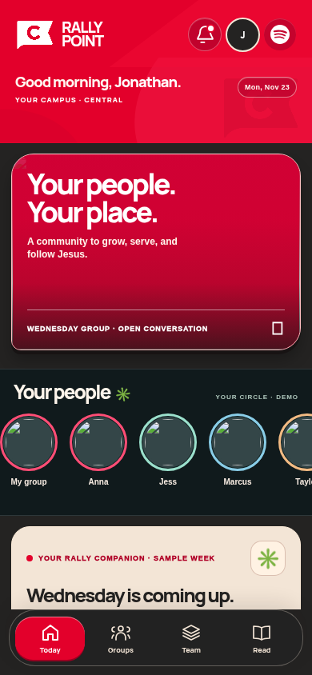
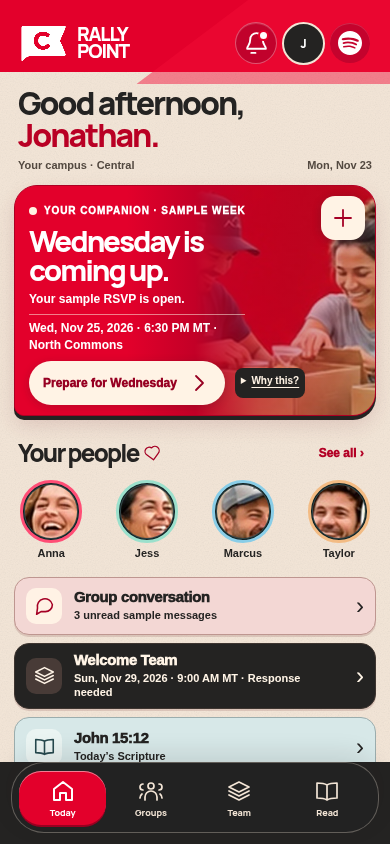

# Rally Point · visual recovery review

Open the review build with `?rc1=1&sampleWeek=1&skipWelcome=1&ntl-drawer-state=hidden`. The sample week and local fixture are fictional. Visual approval belongs to the owner on [draft PR #88](https://github.com/woodrow5087-hue/Citizen-groups/pull/88).

## Matched mobile captures

The browser used the same connected member, Central campus, open group RSVP, pending serving response, and America/Denver clock for the before and after captures. We captured the top of each screen with the bottom navigation visible. The three original November 22 JPEGs were inspected at native size and matched the hashes in the recovery reference. [Recovery reference](RECOVERY_REFERENCE_2026-11-22.md)

| Screen | Width × height | RC1 before | Restored RC1 |
| --- | --- | --- | --- |
| Today | 320 × 568 | [Before](review-2026-11-22/today-320-before.webp) | [After](review-2026-11-22/today-320-after.webp) |
| Today | 390 × 844 | [Before](review-2026-11-22/today-390-before.webp) | [After](review-2026-11-22/today-390-after.webp) |
| Today | 430 × 932 | [Before](review-2026-11-22/today-430-before.webp) | [After](review-2026-11-22/today-430-after.webp) |
| Groups | 320 × 568 | [Before](review-2026-11-22/groups-320-before.webp) | [After](review-2026-11-22/groups-320-after.webp) |
| Groups | 390 × 844 | [Before](review-2026-11-22/groups-390-before.webp) | [After](review-2026-11-22/groups-390-after.webp) |
| Groups | 430 × 932 | [Before](review-2026-11-22/groups-430-before.webp) | [After](review-2026-11-22/groups-430-after.webp) |

| **Today · 390 before** | **Today · 390 after** |
| --- | --- |
|  |  |

The before capture is from `82b9d87b549ffea671850ecbfe59909139910fb8`. The exact Premium ALIVE Hybrid checkpoint `e1b347528526aec62309d58774c712e52c56dbf8` was also built and captured with the same viewport and fixture. [Checkpoint Today](review-2026-11-22/today-390-checkpoint.webp) · [Checkpoint Groups](review-2026-11-22/groups-390-checkpoint.webp)

## Map from references to implementation

| Reference characteristic | Restored screen |
| --- | --- |
| Cream and bold editorial identity in 01 and 03 | Warm textured Today canvas and oversized Manrope greeting with the red name. At 320 px the greeting can run on one line to keep the portraits in the first view. |
| Matte red photo-backed gathering in 01 and the asymmetric lead in 03 | A single large Citizen-red assistant card carries the current priority. The group gathering uses the authorized date, venue, and open RSVP. The action opens the existing RC1 conversation. |
| Charcoal contrast in 02 and the four-phone template | Charcoal serving tile, Groups shell, and bottom navigation. Supporting rows use the approved rose and pale-blue accent treatments. |
| Named people in 01–03 and the pinned checkpoint | Four colored circular profiles with working local conversation links. See all opens the existing People view. |
| Photo-backed Groups from the four-phone direction | The connected group header uses the archive artwork and preserves the charcoal shell. Its cream group feature and contextual shortcuts preserve the existing group routes. |
| Single hierarchy in the recovery brief | Today has one lead and one set of supporting activities. Group conversation, serving, and Scripture appear once when applicable. Groups omits a shortcut when its destination is already the featured action or See all. |

The checkpoint and before build reference remote Unsplash artwork that could not load in the capture environment. The recovery screens use locally packaged crops of the group image and four portrait assets already embedded in `premium-hybrid-archive.html`. These are different photo crops from the checkpoint URLs. They keep the approved photo and circle treatments visible without an external image request in the restored screens. The attached reference files were used for comparison.

## Regression coverage

The visual gate checks the lead, circle rail, supporting-card order, image decoding, portrait visibility above the navigation, unique group shortcuts, and the four tabs. The integrated browser matrix also exercises the real RC1 sheet and current permission checks, explicit RSVP and serving actions, guest and leader states, stale data, and failed writes. The existing Team, Read, onboarding, archive, and game routes remain available. [Browser gate](../../scripts/companion-browser-check.mjs)
