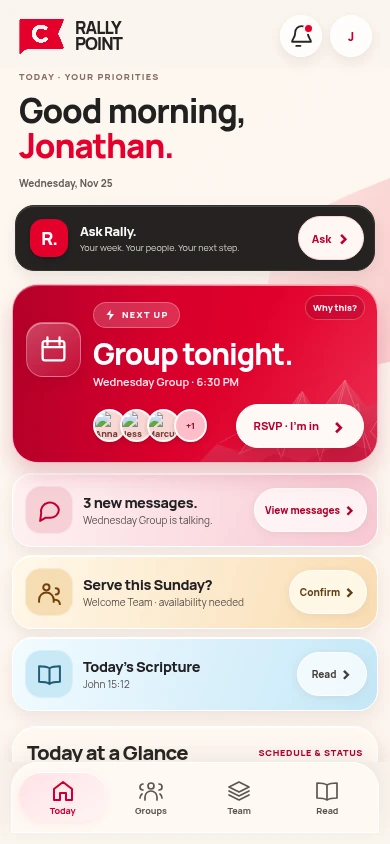
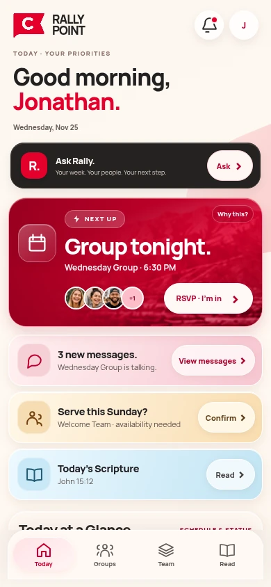
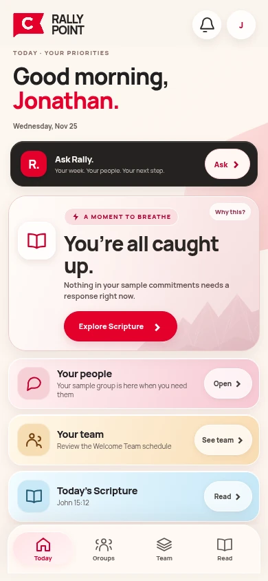
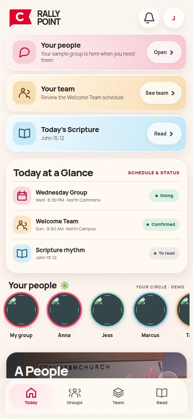
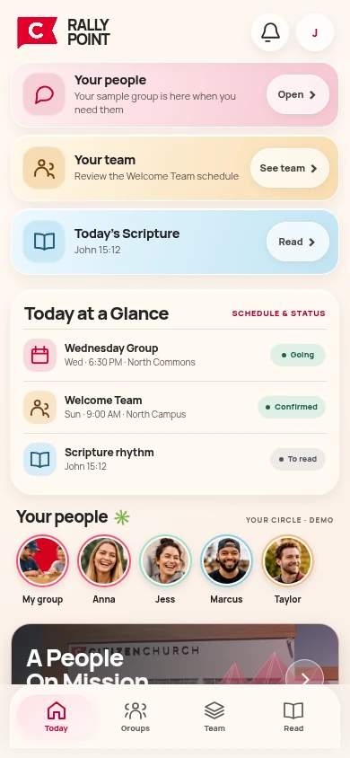

# Preview #73 Today visual review

The comparison uses the existing Preview #73 priority board and Ask Rally entry. The review branch started at `a5f0e16`, which includes the squash merge of Preview #73 and subsequent F-10 companion behavior. This change is visible on Today with `?f10=1&skipWelcome=1`.

## 390 px mobile comparison

Each capture is a 390 × 844 Chromium render of the real app. Both builds use the same fictional member and frozen Wednesday morning fixture in `America/Denver`. The caught-up pair uses a saved RSVP, a confirmed shift, and a visited group conversation. The last pair shows the same state scrolled to the secondary actions, schedule, and profiles.

| State | Before | After |
| --- | --- | --- |
| Group RSVP due tonight |  |  |
| Caught up |  |  |
| Secondary actions, status, and profiles |  |  |

## Review details

- The ridge and four named portraits are clean crops from the supplied visual target. The group thumbnail comes from the existing Premium Hybrid archive. The app serves all six images locally and renders all copy, status, numbers, and controls from the existing fixture state.
- The red photo belongs to the group RSVP hero when that card leads. The caught-up state keeps its quieter blush treatment. The 24-hour priority window still applies. “Group tonight” requires a future gathering on the current local day.
- Priority cards retain their existing actions. Today at a Glance shows schedule and status, and the people rail stays behind existing group membership checks.
