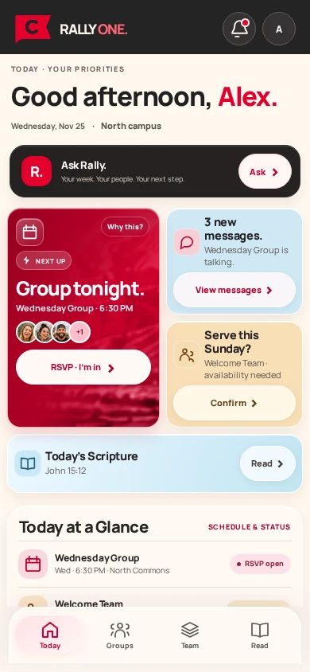
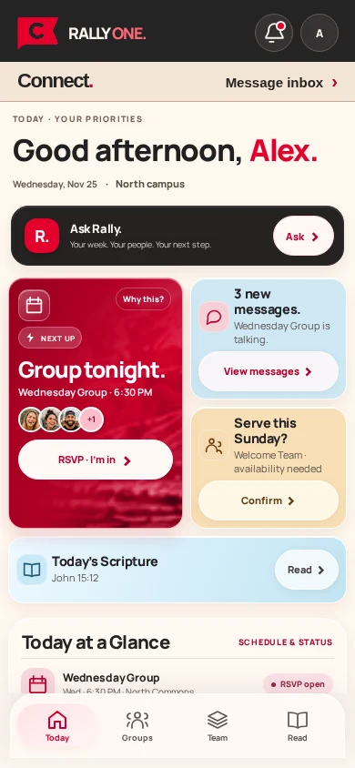
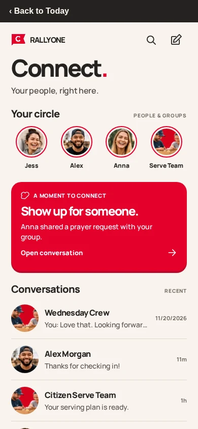
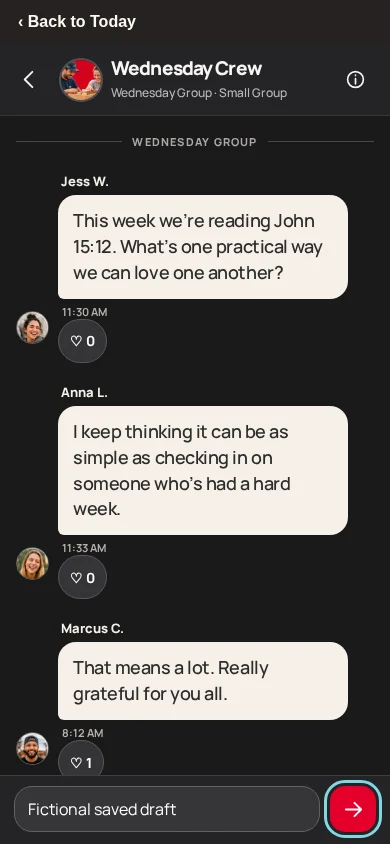
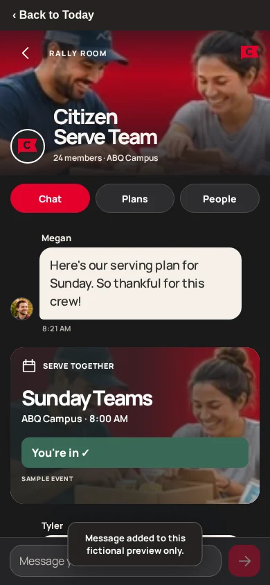

# Milestone 1 review

The four shared destinations are Today, Groups, Team and Read. The labeled Connect / Message inbox strip opens the full inbox from each one, including at zero unread. Back returns to the originating area. The original five-tab comparison is available at `/connect-design-lab.html`.

## Phone evidence

Captured in Chromium at 390 × 844 with fictional fixtures. Open each image for the device-scale capture.

| #101 Today | Integrated Today |
| --- | --- |
|  |  |

| Inbox | Wednesday Crew | Serve Team Rally Room |
| --- | --- | --- |
|  |  |  |

## Verified behavior

- #101 shell checkpoint on the current Develop base. The 233 existing unit checks passed before Connect integration.
- The integrated suite contains 237 passing Node checks. The screen-source fingerprints pin the reviewed app routing changes. Existing game, provider and screen-style fingerprints remain active.
- The preview browser suite exercises new and returning profiles, guest and leader selections, the locked sign-in demo, Back, reduced motion, four tabs, the Priority Board, Ask Rally, RSVP, serving and Scripture. It captures 320, 390 and 430 px layouts.
- The Connect browser suite exercises 320 × 640, 390 × 844, 430 × 932 and 1280 × 900. It opens a direct Today shortcut, checks the persistent inbox entry and return on every tab at zero unread, reloads a saved draft, posts a fictional message and reads it in canonical Groups, reopens a direct message, checks the room RSVP across Chat and Plans, opens People and returns to the same room from Team. It checks guest visibility and refuses to overwrite a malformed Wednesday snapshot.
- Automated accessibility checks cover the integrated inbox, thread, room and guest state. The CI artifact contains the original PNG captures. Physical iPhone Safari, software-keyboard behavior and VoiceOver remain manual acceptance work.
- Production-context and branch-deploy builds were checked locally for their existing entry defaults. Netlify review uses the deploy-preview context.

## Data and comparison boundaries

Wednesday Crew is the Connect presentation of the existing Wednesday Group fixture. Its messages, per-user cursor, draft, reply target and heart reactions use the same F-02 repository as Groups. Canonical Groups retains its advanced chat controls and older archive. Jess and Anna use the existing direct-message histories. Alex is a distinct fictional contact. The Connect room's sample Sunday Teams event is separate from the Welcome Team shift on Today. The room's replies and RSVP persist in local demo state. Guests see an inbox with an empty state.

## Review routes and rollback

- `/` opens the review experience. Use Sign in and the locked demo to see both group and team fixtures.
- `/?rallyOne=1&welcome=1` replays onboarding.
- `/?rallyOne=0` compares the earlier Develop shell.
- `/connect-design-lab.html` opens the original standalone five-tab messaging study.
- #101 commit `2b2a487` is the shell-only rollback checkpoint. Closing the review PR leaves Develop and production at their existing releases.
