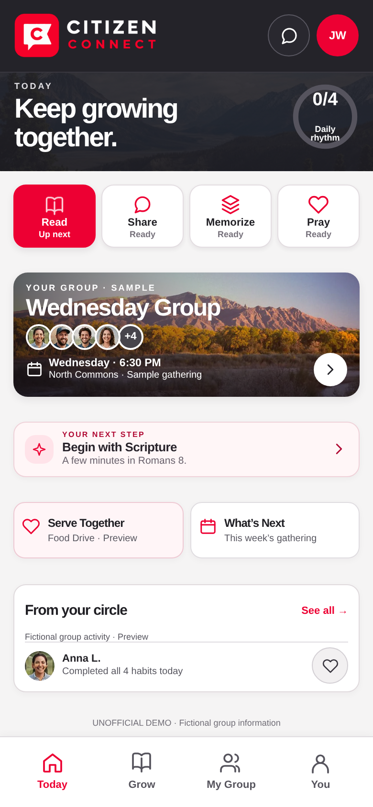
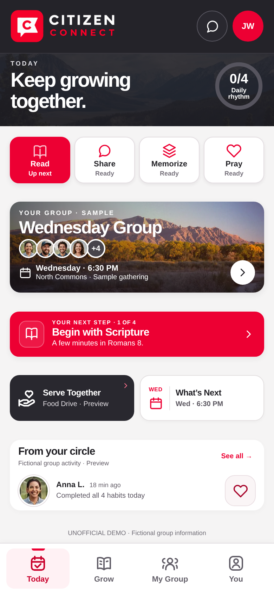
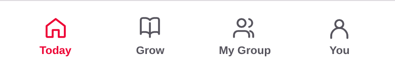
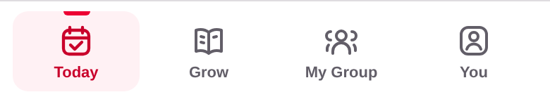

# Citizen Connect v0.3.10 review

Visual refinement based on the latest `feature/hybrid-premium-v032`, commit
`8eea23f`. [Open the visual comparison page](index.html).

## Today at 390 × 844

Both screenshots show the same fresh fictional demo at 2× pixel density.
Read is the first recommended activity. The content viewport is 694 CSS pixels
high in both captures, with no vertical scrolling.

| Before | After |
| --- | --- |
|  |  |

## Bottom navigation close-up

The icon set uses original inline SVG paths with consistent proportions and a
slightly stronger stroke. A small matte-red bar, tinted selected surface and
stronger label distinguish the active destination. All navigation buttons remain
at least 44 × 44 CSS pixels.

| Before | After |
| --- | --- |
|  |  |

## What changed

- Next Step: matte Citizen red, activity-specific icon, stronger title, restrained
  press feedback and a small position indicator. The existing recommendation
  logic still chooses the first incomplete activity.
- Serve Together: charcoal surface and original serving-hands icon. The same
  fictional opportunity preview opens on tap.
- What's Next: calendar styling and the existing Wednesday / 6:30 PM information;
  opens the same group gathering and RSVP controls.
- From your circle: 44px portrait, existing sample timestamp, compact disclosure
  under the heading and a 44px encouragement control with a filled-heart state.
  Its existing notice confirms that no message was sent.
- Navigation: original Today, Grow, My Group and You icons; clear selected state;
  short press/color transitions. Reduced-motion preferences are honored.

## Preservation and review limits

The official supplied logo, all asset files (including Sandia), header, activity
logic, local-day rollover, progress-ring calculation and storage namespace
`citizen-connect-demo-v038` are unchanged. No backend or production settings were
changed. The all-complete summary omits a redundant visible eyebrow to fit the
same compact space; its status still has the accessible name "Your daily rhythm."

Local data remains browser-origin scoped. A new deploy-preview URL has separate
storage; saved work at an earlier preview URL remains there. Loading the new UI
on the same origin retains existing saved progress.

Automated checks use Chromium, including simulated top/bottom safe-area values.
They do not establish physical Safari compatibility. A WebKit run was attempted,
but this environment lacks its GTK/graphics dependencies and cannot install them
system-wide. Physical iPhone/Safari, VoiceOver and device tap-feel review remain
appropriate on the preview. No WebKit pass is claimed.

## Verification results

`npm test`: all 11 tests pass, including every existing regression test.
`node --check app.js`, `node --check scripts/check-mobile.mjs` and
`git diff --check` pass. This static branch has no production bundling step;
its HTML, CSS, JavaScript and assets are served directly.

`CHROMIUM_PATH=/usr/bin/chromium npm run test:browser`: all 11 viewport cases
pass, each checking 0/4 through 4/4 via the actual activity controls. Each fresh
Today also passes the axe WCAG A/AA ruleset (zero detected violations). Reload
persistence, RSVP, encouragement, Serve preview, all four destinations, keyboard
activation, reduced motion and browser/network errors are checked.

| CSS viewport | Simulated insets (top / bottom) | Today scrolling across 0–4 complete |
| --- | --- | --- |
| 320x568 | 0 / 0 | 85–101px; scrollable |
| 375x635 | 0 / 0 | 25–26px; scrollable |
| 375x667 | 0 / 0 | None |
| 390x664 | 0 / 0 | None |
| 375x812 | 0 / 0 | None |
| 375x812 | 47px / 34px | None |
| 390x844 | 0 / 0 | None |
| 390x844 | 47px / 34px | None |
| 430x932 | 0 / 0 | None |
| 430x932 | 59px / 34px | None |
| 1280x900 | 0 / 0 | 22–27px; scrollable |

No horizontal overflow, offscreen Today buttons, or cut-off navigation was found.
The shorter 320 × 568 and 375 × 635 viewports scroll normally to reveal remaining
content; navigation stays visible. All other mobile cases fit the full dashboard
without vertical scrolling in every progress state. All Today controls and
navigation targets meet the 44 × 44 CSS pixel minimum.

[Detailed browser measurements](metrics-chromium.json) include all five states
for each viewport. The screenshots above are viewport captures, not full-page
images hiding a scroll requirement.

## Optional dark appearance

Open **You → Demo controls → Dark appearance** in the preview. Light remains the default; the
choice saves on this device, separately from daily activity.

[Dark Today screenshot](today-dark.png). Both appearances retain the same layout,
brand assets and actions. The appearance switch is keyboard accessible and does
not rerender the screen or discard focused controls or unsaved input.

Appearance verification: all 13 logic tests and 22 Chromium viewport cases pass
(11 sizes/inset combinations in each appearance, with 0/4–4/4 progress states).
Dark mode also passes axe checks across Today, Grow, My Group and You at the
390px safe-area viewport. Keyboard Space toggling was checked in the browser.
Native Safari/VoiceOver review remains a device check, as noted above.

## You refinement

The appearance switch is now in the bottom Demo controls section. The journey
uses a red identity/progress card, stronger stat accents, and original shield,
seal and hexagonal milestone crests. Historical awards remain samples; the
Memorizer state still comes from completing today's practice.

[Light You screenshot](you-light.png) · [Dark You screenshot](you-dark.png).

All 14 logic tests pass. Focused You checks pass at four widths in both
appearances, across Awards, History and Stats, with keyboard switching, bottom
controls, no horizontal overflow, and zero detected axe A/AA violations.

The full 22-case light/dark app regression suite also passes after the You refinement.
