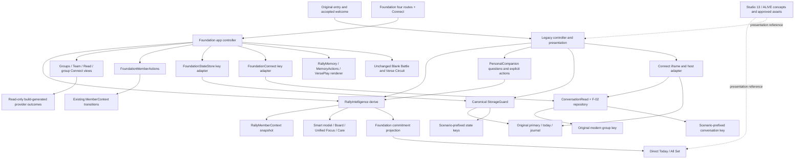
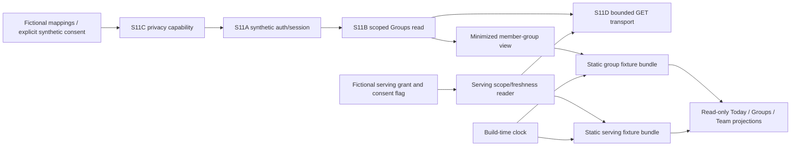

# Rally One CONVERGENCE — Phase 1 audit and coordinated roadmap

**Status:** Phase 1 complete; implementation not authorized. **Date:** November 26, 2026. **Mode:** read-only source/evidence audit. **Canonical authority:** `rally-one/develop`, **`b7bb0687a498f2ba9ab1f2a244b187013ceea339`**, tree `d43e2b8d32396b9ea9f6710b3a1d93c02d171fa6`.

Gate 8 is **closed, accepted and promoted**. This report does not reopen it. No new regression is established here. Existing accepted evidence is reused; no application test, build, browser regression or physical-acceptance suite was rerun. No source, branch, migration, merge, deployment or protection change is made.

## 1. Executive summary

Foundation 2 can be the coherent experience shell around the accepted engines. Its strongest foundations already exist: direct rendering, isolated guarded state, explicit permission-aware actions, shared intelligence inputs, the accepted group-conversation domain, full Classic VersePlay reuse, unchanged standalone games, and minimized synthetic provider projections. The original Rally One remains present and protected in the same canonical source.

**Foundation 2 is not yet a feature-complete default replacement.** The source-backed matrix below identifies 38 capability scopes. Principal remaining work is access/adaptation and coherence: onboarding/profile context, Ask Rally, people/discovery, premium inbox/DM/Rally Room capabilities, fuller care/leader/team interactions, and cross-experience return behavior. Contracts, prototypes and route headings must not be counted as completed product features.

Six findings control the roadmap:

1. **Verified publication boundary:** canonical branch builds do not publish `/foundation2/`; the accepted Foundation experience is still on the immutable PR preview. Root launch-mode defaults also differ by Netlify context. [S38] [S63]
2. **Verified demonstration-date risk:** the accepted preview contains November 28 group and November 29 serving samples. They are build-time snapshots; the browser projectors do not recheck their age or whether the event has passed. On December 2 those samples must be presented as dated examples or handled through an authorized demo-integrity correction. [S34] [S35] [S36] [S37]
3. **Verified accepted policy difference:** Foundation All Set closes outstanding commitments while retaining optional unread/reading activity. Legacy Unified Focus selects up to two actions including unread/care/saved Scripture intentions. Integration must resolve the terminology/decision contract explicitly while retaining one shared context; this is not a newly discovered Gate 8 regression. [S03] [S06] [S51]
4. **Verified future-validation gap:** Foundation mobile acceptance is tied to one head-branch name and narrow paths. It captures screens/geometry/axe but has no immutable Foundation pixel-reference comparison. Legacy historical comparisons remain rigorous and passing. [S47] [S50] [S52] [S53]
5. **Verified fixture-model limit:** weekly local dates roll forward, while saved RSVP/serving responses are global sample fields rather than event-scoped records. This is an accepted demonstration model, not a real recurring schedule; future event binding must use explicit identities. [S07] [S10] [S26] [S74]
6. **Confirmed governance limitation:** no classic branch-protection rules exist per the administrator; effective active rules for `main` and `rally-one/develop` are empty. Manual discipline and source guards are not server enforcement. This is acknowledged governance risk, separate from engineering acceptance.

**December 2 decision:** conditional **GO** for a clearly bounded, fictional Foundation demonstration using the accepted experience and truthful sample framing. **NO GO** for claiming full converged feature parity, a completed default cutover, live Planning Center integration, real member authorization or production readiness.

**Recommended next implementation milestone:** **CONVERGENCE 2A — Controlled Preview and Demo Integrity.** One narrowly scoped branch/PR after separate authorization: make Foundation acceptance applicable to that branch, publish Foundation as an opt-in canonical preview route while preserving the root, make sample-date provenance truthful, and record the demo/source manifest. No default flip, feature expansion or state migration in 2A. Broader convergence follows the single gated sequence in section 6.

### Evidence, method and confidence

- **Verified (V):** inspected canonical source, static dependency/key inventory, private design reference, two published fictional fixture files, or an existing accepted record. **Inference (I):** consequence derived from that source, identified as such. **Proposal (P):** future work, not implemented or authorized. **Unknown (U):** evidence unavailable; no pass/fail invented.
- The untouched working checkout has the same complete Git tree as the authoritative merge. Source links pin the exact canonical commit, not a moving branch. PR #150 is a separate unmerged reference; no code from it is incorporated by this audit.
- **[EV1]** accepted canonical push QA: 929 units, all 21 steps, full configured browser/synthetic regression, 75 protected historical sources/64 pairs and 10 Connect sources/86 pairs at zero raw differences; measured job duration 995 seconds.
- **[EV2]** accepted Foundation mobile review: 72 responsive scenes, zero page errors and axe violations at the tree-identical accepted head. **[EV3]** accepted VersePlay: 172 units, 433 browser checks, 49 comparisons, no console/font failures.
- **[EV4]** owner-confirmed 13/13 physical Safari/VoiceOver acceptance and final closeout. It carries forward; original item IDs/device versions are not itemized in the accessible record. No individual new physical execution is fabricated in this matrix.
- The copied Gate 8 closeout and prior audit-scope proposal under `evidence/gate8/` are historical evidence. This report is the single current CONVERGENCE roadmap.
- Tests mentioned below describe **existing evidence/coverage**, not new runs. A schema or test-file name alone is not proof of a live feature.

## 2. Source-backed feature-parity matrix

“Owner” means software/domain authority, not an inferred staff assignment. State IDs refer to section 4. EV4 is aggregate Gate 8 attestation, not a new physical certification for every capability row. The current-status/owner columns are source findings; the final column is proposed dependency/migration work. Lab-only affordances are reusable assets, not automatically new cutover requirements. The preserved original Rally One baseline is its accepted Rally One launch mode, not every historical Rally Point experiment.

| ID / capability | Current implementation status | Source / domain owner | State | Permissions / privacy | Accepted evidence | Dependencies, deficiencies and proposed migration |
|---|---|---|---|---|---|---|
| C01 — Title, tagline, welcome/onboarding | Legacy implemented; Foundation lacks the full entry flow (tagline appears in visitor card). | RallyWelcome + RallyLaunchMode; Foundation entry/view [S21] [S63] [S01] [S04] | ST1/ST2/ST8 | Fictional profile only; locked demo login is not authentication. | [EV1]/[EV4]; source [S21]/[S01] | Reuse accepted splash/campus/involvement flow; connect to one context before default. G05 |
| C02 — Name, campus, memberships and role | Legacy editable preferences; Foundation scenario selector with Friend/north defaults and six isolated local personas. | RallyToday/AppState/MemberContext; FoundationStateStore [S10] [S07] [S08] | ST1/ST2/ST6/ST8 | Explicit booleans and local leader role; neither is a verified church identity. | [EV1]/[EV2]/[EV4] | Adopt an explicit demonstration context bridge; never silently transfer authority or overwrite legacy preferences. G05/G15 |
| C03 — Four tabs, Connect access, deep links/history | Both implemented; distinct navigation owners. Foundation has ?screen/thread/game and restored window focus/scroll; legacy uses controller + overlay history. | RallyNavigation; FoundationNavigation/App [S66] [S02] [S01] [S72] | ST1/ST8; URL/history | Permission checks belong to domains; routing alone grants no access. | [EV1]/[EV2]/[EV4], official three journeys | Retain both entry points; specify cross-root fallback and launcher return semantics. G10 |
| C04 — Today commitments and explanations | Both implemented, with different accepted presentation policies; Foundation builds three responsibility candidates rather than selecting the shared focus output. | RallyIntelligence/UnifiedFocus; FoundationToday [S05] [S06] [S03] | ST1/ST2/ST4 or ST6/ST7 | Group/team/leader gates; no inference from attendance. | [EV1]/[EV2]; test [S51] | Owner decision on commitment versus recommendation semantics; one explainable shared context, no second ranking engine. G04 |
| C05 — All Set, deferred, visitor and unknown states | Both implemented; Foundation can be All Set with unread activity. It prevents All Set for visitor, unknown response, unavailable or provider-preview modes. | UnifiedFocus/Board versus FoundationToday [S06] [S03] [S51] | ST1/ST6 | Unknown is not zero or completion; optional Scripture is not overdue duty. | [EV1]/[EV2]/[EV4]; explicit accepted test [S51] | Preserve accepted meaning; unify terminology with Ask Rally only after decision. G04 |
| C06 — Ask Rally typed questions, follow-ups and confirmations | Legacy implemented; Foundation does not load the PersonalCompanion UI/service. Shared low-level intelligence is loaded, not equivalent Ask access. | RallyPersonalCompanion + root dialog/action seams [S23] [S05] [S02] [S01] | ST1/ST2/ST4/ST12 | Deterministic/local; scoped conversations reset on context change; explicit actions only. | [EV1]; accepted legacy journey tests | Reuse service and action seams, expose from Foundation over the same current context; no external AI replacement. G06 |
| C07 — Circular people rail, profile and member directory | Legacy interactive profiles/direct-message entry; Foundation Today faces are decorative and Groups has no equivalent directory/profile route. | GroupsV2/legacy controller; FoundationView/Groups [S22] [S04] [S17] | ST2/ST5 or ST6; transient profile route | Fictional approved portraits; membership-scoped messaging. | [EV1]; UX02/UX03 guards; [EV2] limited Foundation | Reuse accepted profiles/IDs and authorized interaction contract; do not substitute initials or fake presence. G08 |
| C08 — Group discovery for visitors | Legacy sample discovery/directory implemented; Foundation provides an in-app introductory destination plus full-demo fallback, not complete discovery. | GroupsV2 + root; FoundationGroups [S22] [S17] | ST1/ST2; Foundation ST6 | Browsing never establishes real or implicit membership. | [EV1]/[EV2]/[EV4] visitor route acceptance | Integrate actual accepted discovery behavior, or explicitly approved destination-specific fallback. G08/G10 |
| C09 — Group gathering, Going/Maybe/clear and Today consistency | Implemented local fixture in both; Foundation also offers explicit clear response. | MemberContext transitions; FoundationGroups/App [S07] [S17] [S02] | ST1 or ST6 | Group membership required; RSVP is not attendance. | [EV1]/[EV2]/[EV4] group journey | Preserve field authority and receipts; connect provider read data without a competing RSVP writer. G15 Undated sample RSVP is not an event-scoped production response; see G22. |
| C10 — Modern group conversation and unread cursor | Both use the same F-02 repository/Read model, but separate keys. Foundation exposes one Wednesday thread only. | RallyConversationRead + mock repository; FoundationConnect [S16] [S27] [S11] | ST4 or ST7 | Active conversation membership/org checks; denied/unavailable expose no bodies; unknown unread stays null. | [EV1]/[EV2]; Foundation Connect source tests | Reuse domain/read cursor; define context and namespace mapping before broader channels. G07/G15 |
| C11 — Group sends, persisted drafts and quoted replies | Implemented in integrated legacy and Foundation; saves are browser-local simulated delivery. | ConnectMember/Wed controller; FoundationConnect/App [S13] [S62] [S11] [S02] | ST4/ST7 | 700-character UI/adapter bounds; safe text; no remote messages or real receipts. | [EV1]/[EV2] group send/reload/reply checks | Retain exact save/read/reply semantics when reusing premium UI. G07 |
| C12 — Group reactions, retry and delivery affordances | Legacy premium group supports heart reactions; reusable Wednesday lab supports multiple reactions and retry. Foundation adapter/view exposes send/reply but no reaction/retry controls. | F-02 repository; ConnectMember/Wed UI [S27] [S13] [S62] [S11] [S12] | ST4/ST7 | Reactions require sent messages/member scope; delivery remains a local simulation. | [EV1]; domain units and lab journeys | Expose existing supported operations via adapter; do not synthesize real delivery/read receipts. G07 |
| C13 — Inbox search, people/new-message chooser and empty states | Accepted premium legacy UI implemented; Foundation has a single-thread inbox and no equivalent search/chooser/portrait rail. | Connect design/member UI; FoundationConnectView [S15] [S13] [S12] | ST4/ST5/ST12 or ST7 | Filter authorized content before search; no private roster for visitor. | [EV1]; 86-pair UX03 coverage; [EV2] limited inbox | Reuse approved UX03 presentation with injected current context and existing owners. G07/G08 |
| C14 — Direct messages, history and per-person drafts | Legacy histories persist through app-state host. Premium direct drafts are an in-memory per-person Map in the open iframe; no reload/close durability shown in that path. Foundation explicitly unmigrated. | Root Connect host + Connect UI [S14] [S15] [S12] | ST5/ST12 | Demo group membership required; display-name mapping is fixture identity, not real authorization. | [EV1]; source Map/host boundary | Preserve history/permissions; reuse or narrowly extract host behavior; decide draft durability instead of claiming it exists. G07/G12 F-03 direct_thread is currently hard-denied [S65]; a direct schema alone is not authorization. |
| C15 — Rally Room Chat/Plans/People and mirrored RSVP | Legacy implemented fictional surfaces; Room messages/RSVP use app-state host, not the modern group repo. Foundation unmigrated. | Root host/ConnectMember/Connect UI [S14] [S13] [S15] [S12] | ST5/ST12 | Team membership; Room event RSVP differs from serving availability. No live presence. | [EV1]; UX03 room/tab/RSVP coverage | Preserve distinct semantics and authentic UI; do not collapse Room RSVP into teamStatus. G07 |
| C16 — Prayer board, adding requests and optional prayer | Legacy prayer posting/board implemented. Foundation shows one explicit source-backed care request and pray/resume controls, not a full posting board. | Legacy primary state/CareFlow; FoundationGroups/MemberActions [S07] [S17] [S20] | ST1 or ST6 | Fictional requests only; no real sensitive information or automatic outreach. | [EV1]/[EV2]; member action/source tests | Reuse explicit care authority; restore required board functions without copying private data into broad context. G09 |
| C17 — Care pause/resume and human direct follow-up | Legacy source-backed care progression/DM completion exists. Foundation has pray/resume and group-conversation entry, not the full pause/private follow-up path. | RallyCareFlow/legacy controller; FoundationGroups [S05] [S07] [S17] [S67] | ST1/ST5 or ST6/ST7 | No inferred distress, spiritual score or unsolicited messages. | [EV1]; accepted care journey; [EV2] narrower | Preserve optional consent and explicit completion; reuse handlers rather than infer care from a group message. G09 |
| C18 — Group leader review and attendance tools | Foundation review of two named fictional follow-ups and Read leader controls implemented; legacy has broader authorized leader/attendance UI. | MemberContext/legacy leader renderer; FoundationGroups [S07] [S17] [S20] [S69] | ST1 or ST6 | Only explicit group-leader fixture; attendance must remain explicit, not inferred. | [EV1]/[EV2]/[EV4] leader permission coverage | Inventory each legitimate tool; do not invent staff scores or treat review as contact/attendance. G09 |
| C19 — Team confirmation/decline and coverage request/withdraw | Both local workflows implemented; Foundation delegates ordinary commands and extends coverage on existing fields. | MemberContext + FoundationMemberActions/Team [S07] [S20] [S18] | ST1 or ST6 | Team member; coverage only after decline; no notifications/delivery. | [EV1]/[EV2]/[EV4] volunteer journey | Preserve shared write authority, confirmation cleanup and no-attendance inference. G15 Bind future responses to a specific shift through contracts, not the rolling fixture date; G22. |
| C20 — Team communication, huddle and leader coordination | Legacy team chat/Room, huddle and authorized schedule/coverage review exist. Foundation has availability/coverage and leader notice; broader communication/tools fallback to full demo. | Legacy Team/root Connect; FoundationTeam [S14] [S18] | ST1/ST5 or ST6 | Team membership and explicit leader role; no automatic staff alerts. | [EV1]; [EV2] narrower Team scope | Reuse existing coordination functions; do not equate a leader notice with complete leader parity. G07/G09 |
| C21 — Scripture, personal prayer, reflection/next-day intention | Foundation and legacy use accepted BSB content; Foundation supports optional read/pray, saved reflection and complete/defer/clear. | RallyMemory + MemberContext/MemoryActions; FoundationRead [S39] [S20] [S19] | ST1 or ST6 | Public Scripture/own local notes; not an assigned calendar or spiritual assessment. | [EV1]/[EV2]/[EV4] Read/progress acceptance | Keep one content engine and private state owner; do not copy Studio KJV/sample mini-state as authority. G15 |
| C22 — Authorized reading pathways/discussion question | Implemented in both over existing plan/planQuestions fields; Foundation supports sermon/study/year. | MemberContext permission + FoundationMemberActions/Read [S07] [S20] [S19] | ST1 or ST6 | Explicit group leader only; no live publishing. | [EV1]/[EV2] Read authorization tests | Retain paths/questions and per-plan storage; validate any additional legacy option before claiming parity. G09 |
| C23 — Premium Read composition and game identity | Legacy premium Read artwork/card identity protected; Foundation has its own accepted direct Read composition and basic game list. Studio mini-game is reference-only. | Legacy UI/UX01E; FoundationRead/CSS [S19] [S55] [S39] [S71] | Presentation; state ST1/ST6 | Existing approved assets only; no silent visual-reference replacement. | [EV1] historical Read guards; [EV2]/[EV4] Foundation | Converge approved visual language by explicit review, preserving all engines/actions and readable text. G14 |
| C24 — Classic VersePlay Solo/Pass & Play | Full original engine/actions/render reused in Foundation; guarded progress persists in its separate namespace. | RallyMemory/RallyMemoryActions/RallyVersePlay [S39] [S40] [S02] [S19] [S73] | ST1/ST9 | Public game content; no link from scores to pastoral assessment. | [EV1]/[EV2]/[EV4] Classic game/progress | Reuse unchanged engine; any progress import requires explicit versioned compatibility/migration. G10/G15 |
| C25 — Blank Battle | Full original standalone engine retained; independent save key. Storage failures are caught so play continues without persistence feedback in that path. | BlankBattle mount + RallyMemory [S41] [S39] | ST10 | Browser-local game only; no actual identity or member score. | [EV1] Blank Battle gate; [EV4] game entry | Preserve engine/key; consider truthful unsaved-session notice separately. G10/G13 |
| C26 — Verse Circuit | Modular full game retained: core transition/content/state, renderer, controller, audio, independent versioned storage. | VersePlay core/controller/render/storage [S43] [S44] [S42] | ST11 | Public content; no sensitive member state; explicit sound preference. | [EV3]; [EV4] entry; [EV1] navigation protection | Keep all engine/content/animation boundaries and migration protections. G10 |
| C27 — Standalone game return to launching experience | Approved Circuit/Blank return links target the legacy root. Foundation Classic returns within Read; standalone launcher origin is not encoded. | Standalone HTML + FoundationRead/navigation [S45] [S46] [S19] [S02] | ST8/ST10/ST11 | Return destination must be a safe internal route; preserve progress. | [EV2]/[EV4] prove Classic return and standalone entry, not a new Foundation-aware standalone return | Define origin-aware adapter/fallback without rewriting games; targeted direct/reload/gameplay return acceptance. G10 |
| C28 — Accessibility, keyboard, text size, reduced motion and focus | Both have substantial accepted coverage. Foundation has 72 captured scenes/axe plus history focus and nav clearance. Premium Connect visualViewport/composer behavior is not all reproduced in Foundation. | Root overlay/UI; Foundation App/CSS [S14] [S02] [S55] [S50] | Transient focus/history/scroll | Semantic controls, no hidden permission-dependent focus targets. | [EV1]/[EV2]/[EV3]/[EV4]; physical details aggregate only | Reuse accepted behavior and add only affected targeted device assertions after changes; no blanket rerun now. G10/G14 |
| C29 — Guarded storage, malformed/blocked/concurrent state | Foundation reuses canonical journal/normalizer with distinct keys; modern chat has its own raw compare/save adapter. Legacy original state remains untouched. | StorageGuard/AppState/Foundation stores/Read model [S09] [S10] [S08] [S11] [S16] | ST1–ST11 | Browser-local storage is not secure member storage; fail closed/preserve original bytes. | [EV1]/[EV2]; Foundation store tests | Design a logical context bridge, not an indiscriminate store merge. G15 |
| C30 — Data migration/rollback | Existing raw-source migration planner and in-memory rehearsal are tools only. No general browser migration/rollback implementation for Foundation cutover. | lib migration planner/rehearsal [S28] | ST15; no live writer | Unknown timestamps/identities must not be invented; backups may contain user-entered local content. | [EV1] includes existing contract tests; source explicitly limits claims | Any real import: explicit approval, exact backups, schema/version/identity map, idempotence, abort and tested rollback. G15 |
| C31 — Unified nine-domain data and quality contract | Provider-neutral validated envelope exists for profile/involvement/relationships/serving/conversations/care/scripture/actions/permissions; not a universally wired screen repository. | MemberContext contract + existing context/action/conversation schemas [S24] [S59] [S25] [S26] | Owner-specific records; tool handoff has no store | Distinguish unavailable/unknown/empty/stale/malformed/confirmed; no identity verification claim. | [EV1] contract units; source [S24] | Keep allowlisted projections; adapt provider outputs at boundaries rather than bind presentation to a provider SDK. G15/G16 |
| C32 — Synthetic Planning Center Groups read | Build-time full synthetic consent/auth/scoped Groups chain; Today/Groups share minimized RO bundle. Empty distinct; stale/outage collapse to unavailable display. | S11A/B/C/D + group builder/projector [S29] [S30] [S31] [S35] [S37] | ST13/ST14 | Only fictional own-member group/gathering; no contacts/roster/prayer/messages. | [EV1]/[EV2]; accepted Gate7 evidence | Preserve chain; add as-of/freshness truth for later demo/cutover, not live access. G02/G16 |
| C33 — Synthetic serving assignment | Narrower build-time grant/consent flag + org/person/campus/team scope, freshness and GET resilience; shared RO Today/Team view. Not real Services API/auth integration. | f2-synthetic-serving + builder/projector [S34] [S36] | ST13 | Fictional serving:read scope; denied/unavailable/stale carry no assignment. | [EV1]/[EV2]; accepted Gate7 evidence | Do not claim the same auth-chain coverage as Groups; real Services contract/auth requires separate authorization. G02/G16 |
| C34 — Authentication, consent, resilience and restricted pilot | Synthetic server/tool contracts and loopback review exist; neither browser experience has live authenticated church integration. | S11A/B/C/D/E, mock access policy [S29] [S30] [S31] [S32] [S33] [S65] | ST14 | Opaque synthetic binding/session, trusted consent, minimized own-member read; candidate retention is not approved church policy. | [EV1] [S11] units and 11E loopback browser gate | Reuse contracts; obtain leadership/security/operations decisions before any live integration. G16 |
| C35 — Publication, regression/source safeguards | Legacy strict 64+86 comparisons intact. Foundation capture/report workflow is branch-specific, has narrow paths and no immutable Foundation pixel comparison. Canonical branch omits Foundation route. | Build + workflows/visual guards [S38] [S47] [S48] [S49] [S50] [S52] [S53] | Build outputs/evidence, not member state | Production remains main; no invented status or baseline relaxation. | [EV1]/[EV2]/[EV3], accepted deployment provenance | Fix future branch applicability and authorize Foundation-specific reference protection before default cutover. G01/G03 |
| C36 — Studio 13 / ALIVE presentation reuse | Studio13 private interactive candidate and screens are creative references; ALIVE/premium widgets/Connect patterns are accepted legacy presentation. Foundation implements its own accepted direct design. | Studio handoff; ALIVE/RallyWidgets/FoundationCSS [S54] [S55] [S56] [S57] | ST16/presentation only | No supplied-photo publication without rights/hosting clearance; no prototype state/role engine reuse. | Private reference inspection + hashes; [EV1]/[EV4] accepted app evidence | Reuse composition, authentic approved portraits, typography, purposeful feedback; retain full existing behaviors and reference boundaries. G14/G17 |
| C37 — Activity/attention access and response receipts | Original has attention badge/dialog derived from existing unread/serving/leader state; not real notifications. Foundation has inline ephemeral receipts and utilities, no equivalent activity entry. | RallyToday + root dialog; Foundation App/View [S75] [S74] [S02] [S04] | ST1/ST2/ST4 or ST6/ST7; receipt text transient | Use current authorized facts; never invent delivered notifications, engagement telemetry or a second attention counter. | [EV1] original navigation/action coverage; [EV2]/[EV4] Foundation receipts | 2B explicitly retain agreed attention entry/action reachability over the same snapshot; G06/G04. No notification service is implied. |
| C38 — Group interest and serving discovery/joining limits | Original sample group interest toggle exists; Foundation intro/fallback has no equivalent toggle. Real serving-team discovery/joining is explicitly not implemented in the original either. | Root groupBrowse/interest and Team empty renderer [S76] [S77] [S17] [S18] | ST1 interest array; no real membership/provider write | Interest is saved locally, not submitted and does not join a group. Serving sample entry is a demo persona, not an assignment request. | [EV1] original guest/discovery suites; [EV2]/[EV4] Foundation route scope | G08: preserve agreed existing sample-interest behavior. Real discovery/joining requires separately approved product/integration work; do not invent it as a parity requirement. |

The filterable [CSV matrix](feature-parity-matrix.csv) and [JSON matrix](feature-parity-matrix.json) contain the same 38 rows. A single Foundation route, an “authorized leader” label or an available schema must not be substituted for the specific capability in a row.

### Integration-contract reconciliation

| Boundary | Verified current state | Convergence requirement |
|---|---|---|
| Identity/profile/campus/involvement | Browser-local onboarding and explicit demo personas own these fields. MemberContext is a read-only projection; `identityVerified:false` is deliberate. | Reuse accepted onboarding and a single current context. Do not turn a campus/name/role selection into authentication. [S07] [S21] [S24] |
| Relationships, conversations and unread | F-02 schema/repository supplies membership/org boundaries and per-user read cursors for the modern Wednesday thread. Legacy DM/Room state is separate. | Preserve field-level ownership; do not make a new inbox unread counter or derive read receipts from viewing a legacy array. [S13] [S14] [S16] [S25] [S27] |
| Gathering/serving/coverage/care/action records | v1 action/source-reference contracts exist; active demo actions still operate on accepted app-state fields. The contract is not an operational scheduling/care backend. | Introduce explicit adapters when needed; do not create a second schedule/action store just for presentation. [S07] [S20] [S26] |
| Nine-domain handoff | Tool/server-only envelope defines profile, involvement, relationships, serving, conversations, care, scripture, actions, permissions and six quality states. | Reuse validation/allowlists and source provenance; distinguish confirmed/empty/unknown/unavailable/stale/malformed. It is not universally wired into browser repositories today. [S24] [S59] |
| Groups provider rehearsal | Build runs synthetic privacy/consent, identity/session, scoped Groups reader and bounded transport; publishes only fictional group/gathering outcome. | Retain that composition. Browser code receives no real authentication capability. Stale and outage both present as unavailable by accepted current policy; empty remains distinct. [S29] [S30] [S31] [S35] [S37] |
| Serving provider rehearsal | Narrower synthetic active/consent grant plus org/person/campus/team scope, freshness and transport. It is not the Groups auth chain and makes no claim about a real Services endpoint. | A future authenticated Services adapter needs its own authorized mapping/contract. Do not advertise symmetric live integration. [S34] [S36] |
| Direct-message policy | Conversation schema can represent `direct`; F-03 access policy explicitly denies `direct_thread` and minor-related resources. Accepted local demo DMs are not proof of approved real DM policy. | Preserve fictional demo functionality, but obtain explicit participant/minors/privacy policy before any real DM authorization. Never tunnel a real DM through group membership. [S25] [S65] |
| Consent/security/operations | Synthetic sessions, trusted administrative consent, bounded reads, revocation/disable and loopback review exist. Candidate 30-day consent/7-day aggregate-audit bounds are code proposals, not approved church policy. | Live identity, notice/consent UX, retention/deletion, provider scopes, incident/kill-switch/operations and independent security review remain separately authorized work. Prayer/messages/pastoral data are outside the existing member-group-view purpose. [S29] [S31] [S32] [S33] [S61] |

## 3. Architecture and dependency map

### Current runtime structure — verified

The shared guard **implementation** writes either original or mapped Foundation keys depending on its injected adapter; Foundation does not write the original app's keys. The group domain implementation is reused while its storage namespaces remain separate. The legacy DM/Room host still writes its accepted primary-state fields. These are distinct ownership facts, not a unified persistence layer. [S08] [S09] [S11] [S14]

Foundation reuses the complete intelligence snapshot but builds its own commitment presentation from context/model/baseline agenda. It does not consume Shared Focus as its action selection. That accepted semantic seam must be addressed before Ask Rally convergence. Foundation's Classic renderer receives a copy of mutable game state to prevent rendering from mutating persisted data. [S02] [S03] [S05] [S06]

### Integration build boundary — verified

This is a synthetic build rehearsal, not a deployed API/session service. The loopback sign-in review lab is expressly not deployable. The browser bundle contains exact F-02 conversation/repository/mock-policy sources, not the server-only privacy/auth/provider modules. Existing comments claiming that bundle is “lab only/not active” are stale; both current entries load it. [S01] [S25] [S29] [S33] [S38] [S68]

### Dependency/maintainability findings

**Measured static facts:** original entry references 31 scripts and 27 stylesheets; Foundation references 30 scripts (including two generated bundles) and two stylesheets. The inspected legacy controller is approximately 1,168 logical lines; Foundation's is approximately 334; PersonalCompanion approximately 624. Counts use text `splitlines`, not runtime profiling. `source-inventory.json` records sizes, hashes, script/style order and static CommonJS dependencies.

**Inference:** global script order and private controller/iframe seams are important coupling points. The long legacy CSS cascade increases review complexity; Foundation's scoped direct design reduces that particular coupling. Counts alone do not establish latency, a performance defect or a reason for a framework rewrite.

**Proposal:** retain domain engines; extract a small reusable application/host seam only where actual convergence is blocked by private functions. Characterize behavior and preserve historical-source reconstructibility. Keep presentation primitives separate from ranking, identity, authorization and IO. `RallyWidgets.apply` decorates existing approved markup; it is not a domain engine or a universal renderer to apply indiscriminately to Foundation. [S54]

### Studio 13 / ALIVE reuse map

| Reference concept | Current comparison and reusable value | Boundary to preserve |
|---|---|---|
| Compact editorial heading, cream priority, restrained Citizen red | Studio 13 reference and accepted Foundation direct Today share this hierarchy. Retain accepted Foundation tokens: brand `#e3002b`, action red `#c91c37`, Manrope and role-specific tonal contrast. | Do not flatten all reds, replace fonts or redraw accepted screens. Existing action color is accepted source, not a new palette defect. [S55] |
| Responsibility-first composition, chronological schedule, calm All Set | Strong creative reference already represented in Foundation; underlying action/count semantics differ from legacy Focus. | Owner chooses semantic contract; no prototype state/count engine, fixed Nov25 dates, or manual Tonight/Sunday/Daily tabs. [S03] [S51] |
| People-first portraits, relational grouping, layered cards | ALIVE, GroupsV2 and accepted UX03 provide working interaction patterns and approved demo imagery. Foundation's decorative portraits do not yet provide profile parity. | Reuse existing IDs, permissions and functional profile controls; no invented presence, roster or sensitive pastoral signal. [S22] [S54] [S56] [S57] |
| Comfortable messaging and compact composer/header | Accepted UX03 supplies richer DM/Room/reply/reaction/keyboard behavior than Studio's illustrative chat. | Reuse accepted presentation/host/domain boundaries; Studio chat state is in-memory sample behavior, not a replacement engine. [S13] [S14] [S15] |
| Scripture/editorial imagery and game identity | Preserve accepted premium Read art, public-domain BSB content and all three full games. Studio's sample KJV card/mini-game illustrates layout only. | Keep content/translation/game authorities; intentional visual changes need separate owner reference approval. [S19] [S39] [S43] |
| Photography | Private master review and interactive HTML inspected; handoff/instruction/HTML hashes match the recorded provenance. | Supplied photos and photo-containing HTML remain private; no rights/hosting approval is inferred. Use approved canonical demo assets or neutral alternatives; never imply pictured people are actual members. |

The Studio HTML has no localStorage/sessionStorage/IndexedDB calls in inspected script: its sample state lives in page globals. ALIVE helpers are presentation-only. Neither is a source for membership, tasks, identity or persistence. Historical assets and PR #150 remain untouched. The handoff's governing HTML SHA256 is `fca3f9a0c5f3d6f411f5b2d61c462b1141d8da8f28e290cc3bc84e1864366a04`; no supplied photography/HTML is redistributed in this audit bundle.

## 4. State and storage ownership map

All browser stores below are **origin-scoped**. Different immutable Netlify hosts, PR aliases, canonical branch alias and production do not automatically share localStorage. Identical source/runtime does not migrate saved data across hosts. Within the same origin, original and Foundation namespaces deliberately coexist.

| ID | State/key or lifetime | Authority and writer | Required preservation/migration boundary |
|---|---|---|---|
| ST1 | `rallypoint-phase1-2026`: role/view/panes, RSVP, serving, care, prayer/message arrays, reading/reflection, game fields | AppState initializes; accepted root/canonical transitions and MemoryActions change fields; StorageGuard commits. [S09] [S10] | Do not copy arbitrary JSON into a new identity context. Retain raw bytes on malformed/blocked saves. |
| ST2 | `rallypoint-today-ui-v1`: name, campus, explicit group/team involvement, onboarding metadata | RallyToday/welcome; shared guard owns commits. [S21] | Display/profile preference is not verification or membership proof for a real service. |
| ST3 | `rallypoint-write-journal-v1` | StorageGuard's before/after transaction/recovery record. [S09] | Guard-only protocol; preserve pending/corrupt originals, concurrency refusal and recovery behavior. |
| ST4 | `rallypoint-wednesday-chat-lab-v1`: versioned snapshot, draft, reply target, messages/reactions/cursors | ConversationRead validates; F-02 repository supplies operations; Wednesday controller and ConnectMember persist. [S13] [S16] [S27] [S62] | This is the modern group unread authority. Do not derive unread from legacy arrays or transfer unknown timestamps as valid records. |
| ST5 | ST1's `directMessages`, `connectRoom.messages`, `connectRoom.rsvp`, `connectPraying`, team/prayer fields | Legacy Connect host and existing root handlers; original guard commits. [S14] | DM history, Room meetup RSVP and serving availability are distinct. No fabricated read receipts/live delivery. |
| ST6 | `rally-one-foundation2-v1:<scenario>:primary`, `:today`, `:journal` | FoundationStateStore maps original guard keys; six explicit local scenarios. [S08] | Original keys untouched; fixture permissions override stored role/membership from other scenarios. Provider modes map to group/team local scopes without writing provider responses. |
| ST7 | `rally-one-foundation2-v1:<scenario>:conversation` | FoundationConnect maps the modern key, reuses F-02/Read and compares prior raw string before save. [S11] | Same schema/domain, isolated content. No second chat state machine; blocked/denied/unavailable cannot claim successful saves. |
| ST8 | `sessionStorage['rally-one-foundation2-v1:selected-scenario']`; `?screen`, `thread`, `game`; history focus/scroll | Foundation app/router; tab-local persona choice and browser history. [S02] | Demo selector is not persisted authenticated membership. Keep safe route allowlist and origin/focus restoration. |
| ST9 | Classic `memoryGames`, mode/active/turn/target/text revision inside ST1 or ST6 | RallyMemory / MemoryActions; owning app guard persists. [S39] [S40] | Same engine, different app save location. No automatic progress merger. Render uses a copy where normalization has side effects. |
| ST10 | `rallypoint-blank-battle-v1` | Blank Battle wrapper and RallyMemory normalization. [S41] | Independent revision-bound progress; catches storage errors and remains session-playable. Existing lack of explicit failure notice is G13. |
| ST11 | `verseplay:verse-circuit:<content.id>`, `verseplay:preferences:v1`; legacy `verse-circuit-design-v1` | Circuit storage schema/validated migration; controller delegates save/load. [S42] [S43] | Keep content/state versions, preference owner, migration and notices; no app-state score/engagement coupling. |
| ST12 | Ask dialog turns/scope/intent; premium Connect per-person draft/scroll Maps and UI toggles | Legacy controller/PersonalCompanion and Connect UI, in memory. [S14] [S15] [S23] | Ask state resets when scope changes. Direct draft Map lasts with iframe; do not promise reload/close durability or introduce a second question/task store. |
| ST13 | Static `FoundationGroupFixtures` and `FoundationServingFixtures` JS payloads | Build-time synthetic readers; read-only browser projectors. [S34] [S35] [S36] [S37] | Not a live cache/session. Preserve minimized fields and explicit as-of/current-data distinction; no browser provider writes. |
| ST14 | Synthetic auth transactions, sessions, consent records and aggregate audit in server/process Maps | S11A/C/E compositions. [S29] [S31] [S33] | Not deployed durable member storage, real consent UX or operational identity. Candidate retention/disable/revocation contracts require independent live approval. |
| ST15 | `rallypoint-f02-uncommitted-review-v1` is a **rehearsal key**, used in an ephemeral Map review | Raw-string migration planner/rehearsal. [S28] | Source explicitly says real storage rollback is not implemented. “Ready review” does not mean migrated or production-ready. |
| ST16 | Studio page globals; ALIVE presentation inputs | Prototype script / pure markup helpers | No business-state ownership, import path or persisted migration source. Retain private original assets and source hashes. |

The older `rallypoint-welcome-preview-session` session marker controls welcome entry, not authentication. F-02 contracts allow a 5,000-character body while active composers/adapter apply a 700-character bound; preserve the currently accepted UI limit instead of accidentally widening it while reusing the schema. [S11] [S21] [S25]

No general Foundation migration has been executed or proven here. An eventual import requires exact backup, explicit schema/identity mapping, idempotence, dry-run validation, interruption/concurrency handling and a rollback that restores the correct owner. It must not invent source timestamps, mark messages read on import or promote a local role to a real grant. [S28]

## 5. Prioritized P0–P3 gap register

Priorities describe future cutover/demo/release exposure, **not a reopening of Gate 8**. P0 is a prerequisite to the named action/claim; P1 is functional/coherence/safeguard work before a full default replacement; P2 is bounded reliability/maintenance work; P3 is deferred optimization. Intentional boundaries, product decisions, unknowns and confirmed gaps are labeled separately.

| ID / priority | Classification and verified evidence | Exposure | Proposed next step | Acceptance dependency |
|---|---|---|---|---|
| G01 — P0 before default cutover | Verified intentional publication/mode boundary. Canonical branch build omits Foundation; branch root defaults board without defaultExperience=rally-one. [S38]/[S63]; accepted canonical route 404. | Wrong demo/default entry; source promotion is not experience cutover. | 2A: additive opt-in Foundation publication for non-production previews, explicit entry/provenance/runbook; keep legacy root and flags unchanged. | Build-context table, exact deploy provenance, legacy byte/pixel parity; no production change. |
| G02 — P0 for December 2 current-data claims | Verified time-bound fixture limitation. Accepted immutable provider bundles contain Nov28 group and Nov29 serving dates. Freshness is checked at build; UI projectors have no now/freshness check. [S34]–[S38]. | Past events could appear ready in a December2 presentation; not a new Gate8 regression. | 2A: record as-of/build identity, retain quality distinctions and guard past/future/freshness presentation; or demo current accepted data explicitly as historical sample. | New date-boundary cases only after authorization; preserve minimized payload/privacy and denied/empty/stale/outage behavior. |
| G03 — P0 before new Foundation implementation branches | Verified validation applicability gap. Foundation workflow hardcodes head_ref and has narrow path filters; independent VersePlay PR/path-only. [S47]/[S48]. | A new branch/shared change can miss mandatory Foundation acceptance. | 2A: make relevant acceptance applicable to the new branch/dependency graph; report omissions/skips explicitly. | Negative coverage checks for shared dependencies/new branch; Tier3 workflow/build validation; unchanged historical guards. |
| G04 — P1; default decision blocker | Verified accepted policy divergence; product decision. Foundation date-sorts three commitment kinds and allows All Set with unread; UnifiedFocus caps two and can prioritize unread/care/due intention. [S03]/[S06]/[S51]. | Today/Ask Rally could tell different stories after integration. | 2B: owner approves mandatory/optional semantics, then use one shared context/decision contract and explainable presentation adapter. | Member/volunteer/leader/overlap/visitor/completed/deferred/unknown scenarios; no silent ranking or All Set change. |
| G05 — P1; default parity blocker | Verified entry/context gap. No full Foundation onboarding/profile editor; per-scenario Friend/north context intentionally isolated. [S01]/[S08]/[S21]. | A default flip could lose apparent personalization or misrepresent memberships. | 2B: reuse accepted welcome/preferences and explicit context adapter; preserve old records and fixture authority. | Existing-session/first-run/campus/guest/role/reload/blocked-storage cases; permission and rollback gates. |
| G06 — P1; default parity blocker | Verified unmigrated capability. Foundation does not load or expose PersonalCompanion Ask Rally. [S01]/[S02]/[S23]. Original activity/attention entry is also not reproduced by Foundation inline receipts; [S75]/[S01]. | Core intelligent-companion access absent from new default. | 2B: reuse deterministic service and explicit action handlers over current shared context. | Today/Ask consistency, no implicit confirmations or unread mutation; privacy and focus parity. |
| G07 — P1; default parity blocker | Verified partial messaging parity. Foundation only supports one group inbox/thread; no DM/Room/search/reaction/retry UI. Legacy channels have different persistence owners. [S11]–[S15]. | A blanket inbox replacement removes accepted behavior or duplicates message state. | 2C: reuse premium presentation, modern group repo and explicit legacy host adapters; inventory DM/Room policies before extension. | Group/team/overlap/visitor, send/reply/reaction/draft/RSVP/denied/unavailable/keyboard/focus; immutable unaffected comparisons. |
| G08 — P1; default parity blocker | Verified people/discovery parity gap. Foundation decorative faces/no full profiles/directory; guest discovery is introductory route/fallback. [S04]/[S17]/[S22]. | Loses people-first interactions and complete discovery. | 2D: reuse accepted profiles/IDs, directory/discovery and authorized action contracts. | Profile origins/return focus, guest restrictions, genuine approved imagery and safe fallbacks. |
| G09 — P1; default parity blocker | Verified partial care/leader/team tools. Foundation exposes narrower prayer/review/Team leader scope than legacy posting, private follow-up, attendance and coordination. [S17]/[S18]/[S20]; root leader views. | Incomplete human follow-up or false completion claims if inferred from generic actions. | 2D: preserve existing explicit actions and distinctions; no score, distress inference, automatic outreach or new pastoral scope. | Role revocation/guest/leader, explicit follow-up and no attendance inference; existing privacy contracts. |
| G10 — P1 before converged journey cutover | Verified return-target boundary; broader keyboard parity unverified. Standalone game return links target legacy root; Foundation launches do not encode origin; Classic internal return is accepted. [S19]/[S45]/[S46]. | Round-trip leaves Foundation/Read context; does not imply game engine regression. | 2D: origin-aware navigation/fallback adapter preserving game engines/stores; retain accepted labels and focus. | Direct entry, reload, gameplay, saved progress, keyboard/VoiceOver return tests only for changed journeys. |
| G11 — P2; demo/cutover planning | Verified platform/context boundary. Immutable deploy, PR alias, canonical branch alias and production are distinct origins; namespaces also differ. | Same code does not transport saved local data across hosts; demo state can appear reset. | 2A runbook selects exact stable origin; later cutover explicitly defines export/import or fresh demo state. | Document URL/origin and key ownership; no blanket cross-origin migration or real records. |
| G12 — P2 | Verified legacy draft durability limit. Premium direct drafts live in a Map; iframe is removed on close; host persists messages but not those draft fields. [S14]/[S15]. | Do not promise all-channel draft reload/close persistence. | 2C: decide desired durability and use one canonical per-conversation owner; characterize preserved behavior before extension. | Same-person/different-person/close/reload/failed-save cases; no cross-recipient draft leakage. |
| G13 — P2 | Verified existing storage feedback limit. Blank Battle catches storage errors and keeps session playable without an explicit save-error notice in that path. [S41]. | A user may expect persistence when storage is blocked. | 2D targeted improvement if authorized; preserve engine/key/gameplay and original bytes. | Blocked/quota/malformed feedback and reload behavior; unchanged game visuals except separately approved notice. |
| G14 — P1 before new default visual reference | Verified Foundation visual-coverage limitation; accepted designs differ. Foundation captures geometry/axe/screens but has no immutable pixel baseline comparison; existing 64+86 protect legacy, not Foundation. [S47]/[S50]/[S51]/[S52]/[S53]. | Future Foundation visual drift can pass legacy guards. | 2A onward: retain legacy comparisons and obtain explicit owner approval before establishing a separate scoped Foundation reference. | Fixed input/clock/font/viewport, complete inventory, strict comparisons/negative controls; never repin to conceal differences. |
| G15 — P1; state migration/default blocker | Verified isolation; migration scope requires decision. F2 namespaces intentionally separate; planner is raw-source/in-memory rehearsal only, not general browser migration. [S08]/[S11]/[S28]. | Silent merge/copy can lose drafts/progress, invent timestamps or grant wrong roles. | 2B–2E: field/source map and versioned opt-in import proposal; reuse guard/contracts; retain same-origin old data for rollback. | Exact backups, identity/schema bounds, idempotence, dry run, concurrency/interruption/rollback; no actual migration until separately authorized. |
| G16 — P0 for live/production claims; P2 for synthetic demo | Verified contract-only integration scope. Group runs full synthetic auth/consent/Groups chain; serving has narrower synthetic grant/transport; F-03 denies direct_thread/minors. [S29]–[S37]/[S65]. | Neither role selector nor schema support constitutes live security/provider/DM authorization. | Keep demo synthetic. Separate leadership/security authorization for real identity, purpose/consent/retention, Services/DM policies, credentials and operations. | Independent security/live staging acceptance in a later authorized program; excluded from December2 claims. |
| G17 — P1 for new image publication | Verified handoff restriction. Studio supplied photos/private HTML lack usage/hosting clearance; ALIVE stock examples are fictional. Private handoff and [S56]. | Uncleared assets or implied real member identity could be published. | Reuse already-approved canonical demo assets or neutral alternatives; obtain rights before new hosting. | Asset/source/license record, explicit owner visual acceptance; no supplied photo publication in this audit. |
| G18 — P2 | Verified maintenance pressure; performance impact unmeasured. Legacy controller ~1168 logical lines; 31 script/27 CSS entry dependencies; Foundation ~334 controller lines, 30 scripts/2 CSS. | Global load order/private host seams and cascade coupling complicate safe reuse. | Extract only a proven reuse seam when needed, retaining behavior/guards; no framework or wholesale rewrite. | Characterization and affected dependency coverage; measure runtime cost before optimization. |
| G19 — P2 | Verified documentation drift. Programme retains pre-acceptance draft/HOLD text; conversation/build headers say main app does not use a bundle that current entries load. [S60]/[S25] and script builder. | Future sessions may repeat closed gates or trust obsolete architecture claims. | 2A: append current architecture/acceptance/deploy manifest and mark historical statements in context, preserving history. | Source-linked documentation and exact canonical/provenance references; no accepted test rerun solely for docs. |
| G20 — P3 | Proposed optimization; baseline evidence only. Gate8 canonical QA job measured 995s; static module counts are not latency results. Existing Actions runtime-deprecation annotation. | Speculative optimization could reduce confidence or consume scope. | After parity: measure comparable workloads and update tooling carefully; retain tests/thresholds. | Comparable exact-source/config/environment timings, no fabricated savings, Tier3 infrastructure gate. |
| G21 — P0 governance, separate admin decision | Confirmed governance limitation, not engineering failure. Administrator found no classic branch rules; effective main/develop active rulesets are empty; existing legacy rule is narrowly scoped. Accepted closeout. | Manual acceptance is not server-enforced protection of merges, pushes or recovery refs. | Separately authorize main/develop and frozen recovery branch/tag protections; no setting change in this phase. | Admin read-only verification of effective targets/check apps/reviews/bypass/update/delete rules; retain authorized break-glass procedure. |
| G22 — P1 before real multi-event/default scheduling claims | Verified accepted fixture-model limit; not a new regression. Local next-event dates roll with browser time; saved rsvp/teamStatus/coverage are global fixture fields, not keyed to event/shift IDs. [S07]/[S10]/[S74]. Action schema has shiftId-bound responses/coverage but no operational gathering-RSVP repository. [S26]. | An older sample response can appear against a later displayed week; it cannot be silently treated as a real response to that future event. | 2A demo framing remains truthful; 2B/2D define current event/source identity and reuse existing shift-response/source-reference contracts. Specify any gathering-response extension under explicit approval; no automatic legacy response migration. | Week/date rollover, past/future events, event change and response isolation; preserve old raw fields and backup. Do not fabricate timestamps or infer attendance. |

The [CSV register](gap-register.csv) and [JSON register](gap-register.json) carry the same 22 findings. No code correction is authorized by a register entry. The source identifies gaps/limits; priorities and remediation are recommendations.

## 6. One coordinated remediation sequence and acceptance gates

**One application lane:** start each subsequently authorized milestone from the then-verified canonical source, use one active implementation branch/PR, complete its gate, then continue the sequence under the relevant authorization. Do not reopen old UX/Studio/CI branches as competing lanes or implicitly merge PR #150/#148. Governance is a separately authorized administrator control decision, not another application development lane.

| Order / proposed milestone | Smallest coherent scope and dependencies | Explicit exit gate |
|---|---|---|
| **2A — Controlled Preview and Demo Integrity (recommended next)** | G01/G02/G03 plus current manifest G19. Make Foundation acceptance apply to the new branch and shared dependencies. Publish Foundation **opt-in** on non-production canonical previews; retain legacy root and current modes, and make existing Rally One-mode fallback/demo links explicit. Make build/as-of/sample-date framing truthful and retain minimized denied/empty/stale/outage behavior. Record exact entry/source/origin and demo boundary. No default flip, new feature, ranking change or state migration. | Tier 3 for workflow/build/data-boundary changes: locked install, required units/integration/browser/mobile/accessibility, protected historical and Connect comparisons, VersePlay as applicable through changed build dependencies, exact-source provider provenance. Legacy protected build inventory/zero-pixel/source assertions remain intact. Foundation new/changed frame review and explicit owner reference approval before pinning any new reference. Test fixture date boundaries and privacy/packaging; physical checks only for materially changed behavior. |
| **2B — Shared member/decision/entry contract** | G04/G05/G06/G15/G22. Owner chooses commitment versus optional recommendation semantics; reuse onboarding, current profile/context and PersonalCompanion. Provide consistent Today/Ask actions/explanations without another engine. Define data handoff and rollback before any migration. | Visitor/member/volunteer/leader/overlap/completed/deferred/unavailable cases; exact action/receipt/unread/permission consistency; first-run/returning/campus/reload, event/week rollover binding and blocked/malformed saves. No implicit confirmations. Full relevant regression and affected visual/device acceptance; no blanket repetition of unchanged Gate 8 evidence. |
| **2C — Conversation convergence** | G07/G12, dependent on 2B context. Reuse accepted premium inbox/DM/Room presentation and group repository; narrowly adapt/extract current host seams. Preserve distinct owners until a separately approved migration exists. Real direct-message/minors policy stays denied unless explicitly authorized. | Membership/org/revocation/visitor isolation, group send/reply/reactions/draft/cursor, DM per-person scope, Room Chat/Plans/People and RSVP, failures, keyboard/visual viewport/reduced motion/origin focus, no cross-recipient draft leakage. Strict unaffected references, approved intentional Connect scope, exact preview and changed-journey device acceptance. |
| **2D — Remaining relational, leader, Read/game journey parity** | G08/G09/G10/G13/G14. Complete required existing people/discovery/care/Team/leader actions and approved Read presentation; retain complete games. Add safe origin return adapters; no engine rewrite or progress-store unification. Lab-only enhancements require explicit scope, not automatic promotion to requirements. | Capability matrix closes every agreed must-preserve row with evidence. Role/privacy/data-quality/receipt consistency, standalone direct-entry/reload/gameplay/return with progress intact, Scripture/leader restrictions, responsive/large text/motion/focus. Full game and historical regression for affected dependencies, owner visual acceptance and targeted physical revalidation. |
| **2E — Controlled preview default cutover** | Only after required parity, shared context and data/rollback decisions close. Execute section 7; no production promotion. | Verified default route and all retained entry/fallback paths, valid source/state mapping, complete configured gates and strict immutable unaffected references, owner acceptance of intentional differences, exact-head deployment and explicit default-cutover authorization. Source and state rollback demonstrated with fictional data. |
| **Later — measured maturity / real-integration proposal** | G18/G20 optimizations only after evidence; G16 real identity/provider/consent/operations only under a separate authorized program. | Comparable performance measurements; independent security/leadership/operations approval before any real pilot. No real records/credentials or production release implied by this roadmap. |

2A must preserve the **purpose and current assertions** of the protected build test, which explicitly pins the existing PR-only condition, and the actual legacy inventory guard. Use an additive context-specific publication boundary or a separately reviewed strengthening of coverage; never delete a guard to ship a route. The GitHub comparison build without actual Netlify context must remain protected. [S38] [S51] [S53]

The owner decision for 2B should explicitly separate **commitments needing a response** from **optional community/care/Scripture recommendations**. A recommended direction is retaining Foundation's calm commitment closure and sourcing optional suggestions/Ask explanations from the shared intelligence snapshot. This is a proposal, not authority to change accepted ranking or All Set. Source-backed permissions and explicit actions remain mandatory either way.

## 7. Controlled Foundation default-experience cutover plan

| Gate | Planned state / authorization boundary | Rollback and evidence |
|---|---|---|
| **C0 Current accepted state** | Original root retained; Foundation only in accepted PR preview; separate demo namespaces. Gate 8 closed. | Existing exact source/ref/deploy evidence. No change in this audit. |
| **C1 Opt-in canonical preview** | After 2A approval, add `/foundation2/` to the canonical non-production preview context. Root and production remain unchanged. Establish a stable demo origin. | Remove/revert the opt-in publication change through normal reviewed source control if necessary; retain original root and all keys. Verify provider commit/context and emitted file inventory. |
| **C2 Functional/context convergence** | Complete agreed parity and action semantics on that opt-in path. Every preserved capability must be reachable through an accepted native route or an explicitly approved context-correct fallback. Generic root links are not proof of destination parity. | Keep previous accepted source and root available. No implicit migration; data-owner map and compatibility rules reviewed first. |
| **C3 Optional synthetic state handoff** | Only if separately authorized: dry run using exact raw backups, explicit schema/identity/key mapping, no fabricated timestamps/reads/roles. Use existing guards/contracts. If not needed, clearly start a fresh fictional session. | Demonstrate abort/idempotence/concurrency and byte-correct rollback. Preserve old namespace. Distinct hosts do not share state; origin change must be deliberate. |
| **C4 Preview default proposal** | Owner approves what “default” means: exact Netlify context, entry URL, welcome, returning session, legacy escape route and role/profile source. Preserve four tabs, Connect, title/tagline, typography, photos and all approved behaviors. No manual Tonight/Sunday/Daily tabs or prototype state engine. | Exact candidate/head and positive/negative packaging checks: preview includes intended experience, production still excludes unauthorized cutover. Retain strict historical references and separately approved Foundation reference. |
| **C5 Preview default acceptance** | Complete applicable full automated gates, new visual-reference acceptance and only affected physical assertions. Verify direct entry, reload, history, deep links, permissions, unavailable/malformed state and game progress. Obtain explicit owner default-cutover authorization. | Revert only the approved default-entry change if gates regress; retain prior accepted route/data. Reconcile any writes by actual owner, not by redirect alone. |
| **C6 Production consideration — excluded** | Requires its own real-auth/data/privacy/consent/operations/security program and explicit production authority. No date or authorization is assumed. | Production `main` and existing published deploy remain untouched throughout C0–C5. |

Changing the app entry is not sufficient to migrate identity or saved state. Future reports must separately certify **source identity**, **deployment context**, **data origin/key ownership**, **feature reachability** and **human acceptance**.

## 8. December 2 executive demonstration readiness

**Target:** Wednesday, December 2, 2026. This is a prospective readiness assessment as of November 26, not a new device/network validation or a delivery guarantee.

| Demonstration claim | Assessment | Evidence / minimum condition |
|---|---|---|
| Accepted Foundation commitment → response → receipt → All Set, group return/RSVP, coverage and Read/Classic | **Conditional GO for bounded fictional demo** | Gate 8 accepted evidence remains valid. Use exact Foundation preview, selected fictional persona and truthful scope. Venue/network/device operational availability is not known for December 2. |
| Full Foundation replacement with Ask Rally, profiles, DM, Room and complete care/leader workflow | **NO GO at current source** | Matrix identifies missing/partial features. Present retained legacy capability separately and label which experience is being shown. |
| Canonical branch link opens Foundation by default | **NO GO at current configuration** | Branch build omits the route. Use accepted PR preview, or subsequently approved 2A opt-in publication. No default cutover is necessary for the bounded demonstration. |
| Provider card is a current/upcoming live Planning Center assignment | **NO GO** | No live integration. Current static group = `2026-11-28T18:00:00Z`; serving = `2026-11-29T16:00:00Z`. Both precede December 2. Use historical/as-of wording or approved fresh/date-truthful sample behavior. |
| Synthetic scope/consent/restricted/empty/outage behavior | **GO as an explicitly synthetic architecture demonstration** | Existing unit/browser acceptance and minimized published sample outcomes; Group/Serving chain differences must be explained accurately. No actual member auth/consent is represented. |
| Complete Studio 13 screen suite or newly cleared Citizen photography | **NO GO as an implemented/rights-cleared claim** | Visual reference is broader than current Foundation parity. Original private photo usage/hosting remains uncleared. Use existing approved imagery. |
| Mobile accessibility of unchanged accepted source | **Accepted evidence available** | Owner 13/13 and automated coverage carry forward. Original device/iOS itemization is limited. New code or a discovered regression triggers only applicable new validation; this audit does not schedule a blanket retest. |

### Current usable review links and origin caution

- **Foundation:** https://6b084f8d62492b74b209f1c5--citizen-connect-test.netlify.app/foundation2/ — accepted PR head, complete tree identical to canonical merge.
- **Original Rally One reference:** https://6b084f8d62492b74b209f1c5--citizen-connect-test.netlify.app/?rallyOne=1 — explicit existing Rally One mode. Do not confuse original-app capabilities with Foundation migration.
- **Canonical legacy-root build:** https://6b086708cfe8cbce7f62b6e0--citizen-connect-test.netlify.app/?rallyOne=1 — source at merge, explicit mode. The stable branch alias is `https://rally-one-develop--citizen-connect-test.netlify.app`; at the accepted build Foundation is not published there. New publication is proposed only.

Local RSVP/serving status is generic fixture state, not a new response automatically recorded for each rolling date. Choose a known fictional demo state; do not silently apply an old confirmation to a newly claimed real event. [S07] [S10] [S74]

When showing retained original-app functionality, explicitly select the corresponding fictional profile there; persona/key namespaces are not synchronized. Label the experience switch instead of presenting it as a seamless shared member session.

Do not rely on progress moving between these hosts. Choose the exact presentation origin and fictional saved state deliberately. Standalone game branding returns to the root; Classic has the accepted Foundation Read return. A short executive demo can use Classic for that coherent loop without making a false full-round-trip claim for the other launches.

### Suggested bounded runbook and decision calendar — proposal

1. Explain the purpose: helping people be known and cared for after they join. State fictional/browser-local/synthetic scope once clearly.
2. Use Volunteer or Group+Team to show a real existing explicit response, saved receipt and calm commitment closure. Unread/reading remain optional invitations.
3. Show Group Maybe → Today consistency and group conversation return; demonstrate a local draft/reply only as sample messaging.
4. Show a named fictional care/leader responsibility and optional Read/reflection/Classic. Clearly identify broader legacy Ask Rally/DM/Room if shown separately.
5. Explain the read-only synthetic provider/failure boundary and the next convergence milestone. Do not show past sample dates as upcoming real appointments.

| Proposed date | Decision/output | Dependency |
|---|---|---|
| Nov27 | Owner selects bounded demo claims and whether to authorize 2A; names presenter and stable origin. | Product decision; no code work assumed. |
| Nov28–30 | If authorized, execute only 2A and its gates; otherwise retain accepted preview with dated-sample framing. | Actual engineering availability/approval unknown; no completion estimate invented. |
| Dec1 | Freeze chosen commit, exact preview, source manifest, origin/persona and honest narrative. Verify link/fixture availability operationally. | New implementation must pass its applicable gates; unchanged accepted suites are not repeated without cause. |
| Dec2 | Demonstrate the accepted bounded experience; disclose remaining convergence and live-integration limits. | Operational device/network availability; fallback uses retained source/screens without claiming new live validation. |

Keep the December 2 scope within accepted prototype behavior plus any separately approved demo-integrity changes. Complete feature convergence follows the gates after that; this roadmap does not promise all remaining capabilities by December 2.

## 9. Separate governance recommendations

**Current evidence:** administrator-confirmed absence of classic rules; API-confirmed empty effective main/develop active rulesets. Existing ruleset 27798928 protects only specific legacy reference branches against deletion/non-fast-forward. The limitation was acknowledged when the owner authorized Gate 8 promotion; it is not an engineering failure or an unclosed acceptance gate. No settings change is authorized in this phase. [EV4]

| Control area | Proposed administrator action after separate authorization | Verification required |
|---|---|---|
| Canonical development | Active rule/ruleset on `refs/heads/rally-one/develop`: PR-only changes, appropriate independent review, actual required checks scoped to trusted apps, conversation resolution, blocked force-push/deletion and explicit admin/bypass handling. Choose up-to-date requirement or merge queue coherently. | Confirm effective branch target, exact contexts/source apps and legitimate reviewer availability. Fix Foundation applicability before treating a skipped `capture` as protection. Required gate must reject a missing mandatory suite; selection cannot validate itself. |
| Production | Separate stronger rule on `refs/heads/main`; protect merge/release authority, checks/review and force/delete boundaries. Retain explicit production authorization. | Record approval count/owners and narrow logged emergency process; do not silently use unrestricted administrator bypass. No main/deploy change here. |
| Frozen recovery branches | Target actual `rally-one/checkpoints/**` and other explicitly inventoried recovery/reference branches. Restrict **updates** and deletion, not only non-fast-forward. | A fast-forward can still move a supposedly frozen branch under deletion/non-fast-forward-only rules. Verify exact refs/SHA manifests and authorized creation/recovery actors. |
| Frozen recovery tags | Separate tag-targeting rule for `rally-one/checkpoints/**` (full ref prefix `refs/tags/`), plus other inventoried recovery tags. Restrict updates/deletion and control creation/release actors. | Verify both annotated tag object and peeled commit; retain off-repository evidence/backups. Immutable Git objects alone do not prevent ref deletion or loss of reachability. |
| Required validation/release evidence | Bind stable always-reported acceptance contexts to trusted issuers; preserve zero-pixel/reference/inventory guards and provider-native provenance. Keep merge source/parents/tree and deployment manifests. | Source changes to workflow/security/shared infrastructure cannot self-classify into reduced coverage or pass because a mandatory job was skipped. No manufactured Netlify status. |
| Ownership and emergency access | Assign actual engineering/security/release/leadership reviewers; choose approval counts and CODEOWNERS where appropriate. Use a narrow documented break-glass path with review/recording. | Do not invent staff assignments or require unavailable reviewers without an owner decision. Preserve the accepted merge/source traceability model. |

Recommended control order: confirm actual owners/check applicability → authorize settings → protect main/develop → protect frozen branch/tag inventories → capture effective-rule evidence. This is an administrative dependency around the single convergence lane, not a second feature branch or permission granted to this agent by the audit.

## Decisions and unknowns retained for the owner

1. Approve the bounded December 2 narrative and the exact meaning/timing of a future preview “default.”
2. Authorize **2A only** as the next implementation milestone if desired; no broader runtime work is implied.
3. Before 2B, settle commitment/optional recommendation semantics and current member-context ownership; before broader messaging, settle fixture/live DM and participant/minors boundaries.
4. Decide whether any existing fictional saved data must be imported at cutover, and approve that migration separately. No real records enter this lane.
5. Assign actual governance reviewers and protection settings separately; decide rights/hosting for any new photography.

Unknowns: December 2 venue/network/presentation device; original 13 physical check IDs/iOS details; authorized photo rights; future real-provider permissions/credentials/operations; complete new-cutover requirements not yet owner-approved. They are not filled with assumptions. The original data/roles remain fictional, and no live deployment readiness is inferred.

### Deliverable and read-only record

This single roadmap is supported by the matrix/register CSV+JSON, canonical source-citation catalog, static source/dependency inventory, design-reference hashes and published fictional fixture observation. Source and reference assets are unchanged; no supplied photos or photo-containing prototype HTML are republished. The final read-only verification records repo cleanliness and opening/closing refs. Gate 8's accepted closeout remains the release evidence; this audit adds no retroactive test or approval requirement.

### Canonical source and accepted evidence references

All S-links pin the authoritative merge; source-citations.json supplies each scope and anchor. No reference points to unmerged PR #150 as a functional authority.

[S01]: https://github.com/woodrow5087-hue/Citizen-groups/blob/b7bb0687a498f2ba9ab1f2a244b187013ceea339/foundation2/index.html#L23 "Foundation entry, personas, dependencies and legacy fallback"
[S02]: https://github.com/woodrow5087-hue/Citizen-groups/blob/b7bb0687a498f2ba9ab1f2a244b187013ceea339/foundation2/app.js#L49 "Foundation state/context, event controller and route effects"
[S03]: https://github.com/woodrow5087-hue/Citizen-groups/blob/b7bb0687a498f2ba9ab1f2a244b187013ceea339/foundation2/today-model.js#L6 "Commitment projection, All Set eligibility and optional signals"
[S04]: https://github.com/woodrow5087-hue/Citizen-groups/blob/b7bb0687a498f2ba9ab1f2a244b187013ceea339/foundation2/today-view.js#L29 "Direct Today/All Set and optional utility composition"
[S05]: https://github.com/woodrow5087-hue/Citizen-groups/blob/b7bb0687a498f2ba9ab1f2a244b187013ceea339/rally-one-intelligence.js#L18 "Shared deterministic context/model/focus snapshot"
[S06]: https://github.com/woodrow5087-hue/Citizen-groups/blob/b7bb0687a498f2ba9ab1f2a244b187013ceea339/rally-one-unified-focus.js#L25 "Shared eligibility, weighted selection and two-action limit"
[S07]: https://github.com/woodrow5087-hue/Citizen-groups/blob/b7bb0687a498f2ba9ab1f2a244b187013ceea339/rally-one-member-context.js#L18 "Canonical demonstration permissions, care and transitions"
[S08]: https://github.com/woodrow5087-hue/Citizen-groups/blob/b7bb0687a498f2ba9ab1f2a244b187013ceea339/foundation2/state-store.js#L22 "Namespaced fixture persistence and canonical guard reuse"
[S09]: https://github.com/woodrow5087-hue/Citizen-groups/blob/b7bb0687a498f2ba9ab1f2a244b187013ceea339/rallypoint-storage-guard.js#L10 "Original primary/UI/journal keys and guarded writes"
[S10]: https://github.com/woodrow5087-hue/Citizen-groups/blob/b7bb0687a498f2ba9ab1f2a244b187013ceea339/rally-one-app-state.js#L9 "Existing compatible state fields/defaults/normalization"
[S11]: https://github.com/woodrow5087-hue/Citizen-groups/blob/b7bb0687a498f2ba9ab1f2a244b187013ceea339/foundation2/connect-adapter.js#L13 "Namespaced modern group domain/read cursor adapter"
[S12]: https://github.com/woodrow5087-hue/Citizen-groups/blob/b7bb0687a498f2ba9ab1f2a244b187013ceea339/foundation2/connect-view.js#L13 "Group inbox/thread UI and explicit migration limits"
[S13]: https://github.com/woodrow5087-hue/Citizen-groups/blob/b7bb0687a498f2ba9ab1f2a244b187013ceea339/connect-member.js#L39 "Integrated group repository, reactions, drafts and host-backed channels"
[S14]: https://github.com/woodrow5087-hue/Citizen-groups/blob/b7bb0687a498f2ba9ab1f2a244b187013ceea339/rallypoint.js#L654 "Connect host interface, DM/Room app-state writes and focus/keyboard"
[S15]: https://github.com/woodrow5087-hue/Citizen-groups/blob/b7bb0687a498f2ba9ab1f2a244b187013ceea339/connect-design-lab.js#L18 "Per-person draft Map, search, composer and room tabs"
[S16]: https://github.com/woodrow5087-hue/Citizen-groups/blob/b7bb0687a498f2ba9ab1f2a244b187013ceea339/rallypoint-conversation-read-model.js#L10 "Modern conversation key/schema/fixture/read-cursor authority"
[S17]: https://github.com/woodrow5087-hue/Citizen-groups/blob/b7bb0687a498f2ba9ab1f2a244b187013ceea339/foundation2/groups.js#L14 "Groups RSVP/care/leader UI and discovery fallback"
[S18]: https://github.com/woodrow5087-hue/Citizen-groups/blob/b7bb0687a498f2ba9ab1f2a244b187013ceea339/foundation2/team.js#L14 "Team availability/coverage and limited leader presentation"
[S19]: https://github.com/woodrow5087-hue/Citizen-groups/blob/b7bb0687a498f2ba9ab1f2a244b187013ceea339/foundation2/read.js#L15 "Scripture/reflection/leader paths and full game launchers"
[S20]: https://github.com/woodrow5087-hue/Citizen-groups/blob/b7bb0687a498f2ba9ab1f2a244b187013ceea339/foundation2/member-actions.js#L24 "Additional Read/coverage transitions delegating canonical actions"
[S21]: https://github.com/woodrow5087-hue/Citizen-groups/blob/b7bb0687a498f2ba9ab1f2a244b187013ceea339/rallypoint-welcome.js#L38 "Accepted welcome/onboarding/preferences and guarded commit"
[S22]: https://github.com/woodrow5087-hue/Citizen-groups/blob/b7bb0687a498f2ba9ab1f2a244b187013ceea339/rally-one-groups-v2.js#L19 "Accepted people rail, profiles, discovery and Groups widgets"
[S23]: https://github.com/woodrow5087-hue/Citizen-groups/blob/b7bb0687a498f2ba9ab1f2a244b187013ceea339/rallypoint-personal-companion.js#L1 "Deterministic Ask Rally language/context/response service"
[S24]: https://github.com/woodrow5087-hue/Citizen-groups/blob/b7bb0687a498f2ba9ab1f2a244b187013ceea339/lib/member-context-contract.cjs#L1 "Nine-domain provider-neutral quality envelope, tool/server only"
[S25]: https://github.com/woodrow5087-hue/Citizen-groups/blob/b7bb0687a498f2ba9ab1f2a244b187013ceea339/lib/conversation-contracts.cjs#L1 "Versioned conversation/message/reaction/read-cursor schema"
[S26]: https://github.com/woodrow5087-hue/Citizen-groups/blob/b7bb0687a498f2ba9ab1f2a244b187013ceea339/lib/action-contracts.cjs#L27 "Action/source-reference/gathering/serving/care schema"
[S27]: https://github.com/woodrow5087-hue/Citizen-groups/blob/b7bb0687a498f2ba9ab1f2a244b187013ceea339/lib/mock-conversation-repository.cjs#L58 "Membership/org-scoped message/reaction operations"
[S28]: https://github.com/woodrow5087-hue/Citizen-groups/blob/b7bb0687a498f2ba9ab1f2a244b187013ceea339/lib/migration-rehearsal.cjs#L34 "Uncommitted raw-source review and in-memory rollback only"
[S29]: https://github.com/woodrow5087-hue/Citizen-groups/blob/b7bb0687a498f2ba9ab1f2a244b187013ceea339/pilot/s11a-synthetic-auth.cjs#L58 "Synthetic auth challenge, grant/session and scoped reader"
[S30]: https://github.com/woodrow5087-hue/Citizen-groups/blob/b7bb0687a498f2ba9ab1f2a244b187013ceea339/pilot/s11b-synthetic-planning-center.cjs#L16 "Bounded synthetic Groups read, validation and freshness"
[S31]: https://github.com/woodrow5087-hue/Citizen-groups/blob/b7bb0687a498f2ba9ab1f2a244b187013ceea339/pilot/s11c-synthetic-privacy.cjs#L9 "Purpose/field allowlists, candidate retention, trusted consent"
[S32]: https://github.com/woodrow5087-hue/Citizen-groups/blob/b7bb0687a498f2ba9ab1f2a244b187013ceea339/pilot/s11d-resilient-transport.cjs#L7 "Bounded idempotent GET-only resilience, no network client"
[S33]: https://github.com/woodrow5087-hue/Citizen-groups/blob/b7bb0687a498f2ba9ab1f2a244b187013ceea339/pilot/s11e-local-review.cjs#L1 "Loopback-only synthetic review composition"
[S34]: https://github.com/woodrow5087-hue/Citizen-groups/blob/b7bb0687a498f2ba9ab1f2a244b187013ceea339/pilot/f2-synthetic-serving.cjs#L22 "Synthetic serving scope/consent/freshness and build-time dates"
[S35]: https://github.com/woodrow5087-hue/Citizen-groups/blob/b7bb0687a498f2ba9ab1f2a244b187013ceea339/scripts/build-group-preview.cjs#L15 "Build-time synthetic group observation and static outcome"
[S36]: https://github.com/woodrow5087-hue/Citizen-groups/blob/b7bb0687a498f2ba9ab1f2a244b187013ceea339/foundation2/serving-preview.js#L23 "Read-only serving projection without runtime freshness clock"
[S37]: https://github.com/woodrow5087-hue/Citizen-groups/blob/b7bb0687a498f2ba9ab1f2a244b187013ceea339/foundation2/group-preview.js#L22 "Group ready/empty/restricted/unavailable projection"
[S38]: https://github.com/woodrow5087-hue/Citizen-groups/blob/b7bb0687a498f2ba9ab1f2a244b187013ceea339/scripts/build.cjs#L10 "Context-specific legacy root and PR-only Foundation publication"
[S39]: https://github.com/woodrow5087-hue/Citizen-groups/blob/b7bb0687a498f2ba9ab1f2a244b187013ceea339/rallypoint-memorize.js#L1 "Accepted BSB content and Classic/Blank Battle engine"
[S40]: https://github.com/woodrow5087-hue/Citizen-groups/blob/b7bb0687a498f2ba9ab1f2a244b187013ceea339/rally-one-memory-actions.js#L9 "Accepted Classic game action owner"
[S41]: https://github.com/woodrow5087-hue/Citizen-groups/blob/b7bb0687a498f2ba9ab1f2a244b187013ceea339/blank-battle.js#L10 "Independent game key, normalization and silent storage fallback"
[S42]: https://github.com/woodrow5087-hue/Citizen-groups/blob/b7bb0687a498f2ba9ab1f2a244b187013ceea339/verseplay/core/storage.js#L1 "Independent content-keyed game saves/preferences/legacy migration"
[S43]: https://github.com/woodrow5087-hue/Citizen-groups/blob/b7bb0687a498f2ba9ab1f2a244b187013ceea339/verseplay/games/verse-circuit/controller.js#L1 "Circuit engine/content/storage/render/sound composition"
[S44]: https://github.com/woodrow5087-hue/Citizen-groups/blob/b7bb0687a498f2ba9ab1f2a244b187013ceea339/verseplay/core/circuit-engine.js#L1 "DOM-free Circuit transition engine"
[S45]: https://github.com/woodrow5087-hue/Citizen-groups/blob/b7bb0687a498f2ba9ab1f2a244b187013ceea339/verse-circuit-playground.html#L18 "Approved accessible return link targets legacy root"
[S46]: https://github.com/woodrow5087-hue/Citizen-groups/blob/b7bb0687a498f2ba9ab1f2a244b187013ceea339/blank-battle.html#L17 "Approved standalone return link targets root"
[S47]: https://github.com/woodrow5087-hue/Citizen-groups/blob/b7bb0687a498f2ba9ab1f2a244b187013ceea339/.github/workflows/foundation2-review.yml#L3 "PR/path/head-branch-conditioned Foundation acceptance"
[S48]: https://github.com/woodrow5087-hue/Citizen-groups/blob/b7bb0687a498f2ba9ab1f2a244b187013ceea339/.github/workflows/verseplay.yml#L3 "PR/path-conditioned independent VersePlay acceptance"
[S49]: https://github.com/woodrow5087-hue/Citizen-groups/blob/b7bb0687a498f2ba9ab1f2a244b187013ceea339/.github/workflows/rally-point-preview-qa.yml#L3 "Canonical push and PR comprehensive legacy/functional/visual gate"
[S50]: https://github.com/woodrow5087-hue/Citizen-groups/blob/b7bb0687a498f2ba9ab1f2a244b187013ceea339/scripts/foundation2-browser-check.mjs#L419 "Accepted three journey assertions and capture-only visual report"
[S51]: https://github.com/woodrow5087-hue/Citizen-groups/blob/b7bb0687a498f2ba9ab1f2a244b187013ceea339/test/foundation2-today.test.cjs#L7 "Accepted commitment-only All Set with unread activity"
[S52]: https://github.com/woodrow5087-hue/Citizen-groups/blob/b7bb0687a498f2ba9ab1f2a244b187013ceea339/test/helpers/ux03-visual.cjs#L10 "Fixed immutable inventory/source/raw-zero guards and fixture pose"
[S53]: https://github.com/woodrow5087-hue/Citizen-groups/blob/b7bb0687a498f2ba9ab1f2a244b187013ceea339/scripts/s8-visual-regression.mjs#L49 "Protected historical sources and intentional visual scopes"
[S54]: https://github.com/woodrow5087-hue/Citizen-groups/blob/b7bb0687a498f2ba9ab1f2a244b187013ceea339/rally-one-widgets.js#L1 "Existing presentation-only decorations, no domain ownership"
[S55]: https://github.com/woodrow5087-hue/Citizen-groups/blob/b7bb0687a498f2ba9ab1f2a244b187013ceea339/foundation2/design.css#L4 "Accepted Foundation font/tokens/component rules and touch/motion"
[S56]: https://github.com/woodrow5087-hue/Citizen-groups/blob/b7bb0687a498f2ba9ab1f2a244b187013ceea339/docs/PREMIUM_ALIVE_HYBRID_V01_IMPLEMENTATION.md#L3 "Historical ALIVE concept and fictional/asset limitations"
[S57]: https://github.com/woodrow5087-hue/Citizen-groups/blob/b7bb0687a498f2ba9ab1f2a244b187013ceea339/docs/rally-one/m2/CONNECT-ALIVE-V1.md#L3 "Accepted people-first messaging concept and host boundary"
[S59]: https://github.com/woodrow5087-hue/Citizen-groups/blob/b7bb0687a498f2ba9ab1f2a244b187013ceea339/engineering/s8-data-contracts.md#L1 "Contract quality/ownership and future provider boundary"
[S60]: https://github.com/woodrow5087-hue/Citizen-groups/blob/b7bb0687a498f2ba9ab1f2a244b187013ceea339/engineering/foundation2-development-program.md#L1 "Historical phased acceptance and current documented boundaries"
[S61]: https://github.com/woodrow5087-hue/Citizen-groups/blob/b7bb0687a498f2ba9ab1f2a244b187013ceea339/engineering/s11e-restricted-pilot-readiness.md#L1 "Synthetic-only pilot limits and future leadership decisions"
[S62]: https://github.com/woodrow5087-hue/Citizen-groups/blob/b7bb0687a498f2ba9ab1f2a244b187013ceea339/wednesday-chat-lab.js#L4 "Existing reusable group controller, draft/reply/reaction/retry/save"
[S63]: https://github.com/woodrow5087-hue/Citizen-groups/blob/b7bb0687a498f2ba9ab1f2a244b187013ceea339/rally-one-launch-mode.js#L9 "Existing runtime mode resolution; canonical branch not automatic Rally One"
[S64]: https://github.com/woodrow5087-hue/Citizen-groups/blob/b7bb0687a498f2ba9ab1f2a244b187013ceea339/index.html#L13 "Legacy entry styles/scripts and preserved experience"
[S65]: https://github.com/woodrow5087-hue/Citizen-groups/blob/b7bb0687a498f2ba9ab1f2a244b187013ceea339/lib/mock-access-policy.cjs#L1 "Contract-level synthetic permissions and org boundaries"
[S66]: https://github.com/woodrow5087-hue/Citizen-groups/blob/b7bb0687a498f2ba9ab1f2a244b187013ceea339/rally-one-navigation.js#L9 "Legacy route effects and authorized Connect redirection"
[S67]: https://github.com/woodrow5087-hue/Citizen-groups/blob/b7bb0687a498f2ba9ab1f2a244b187013ceea339/rally-one-care-flow.js#L17 "Explicit named fictional care progression and optional human action"
[S68]: https://github.com/woodrow5087-hue/Citizen-groups/blob/b7bb0687a498f2ba9ab1f2a244b187013ceea339/scripts/build-chat-lab.cjs#L12 "Exact bundled F-02 sources and stale lab-only header"
[S69]: https://github.com/woodrow5087-hue/Citizen-groups/blob/b7bb0687a498f2ba9ab1f2a244b187013ceea339/rallypoint.js#L113 "Legacy explicit attendance and fictional follow-up renderer"
[S70]: https://github.com/woodrow5087-hue/Citizen-groups/blob/b7bb0687a498f2ba9ab1f2a244b187013ceea339/package.json#L3 "Existing commands and declared Node/development dependencies"
[EV1]: https://github.com/woodrow5087-hue/Citizen-groups/actions/runs/45864800091
[EV2]: https://github.com/woodrow5087-hue/Citizen-groups/actions/runs/45849062005
[EV3]: https://github.com/woodrow5087-hue/Citizen-groups/actions/runs/45849062258
[EV4]: evidence/gate8/consolidated-promotion-report.md

[S71]: https://github.com/woodrow5087-hue/Citizen-groups/blob/b7bb0687a498f2ba9ab1f2a244b187013ceea339/rallypoint.js#L468 "Accepted legacy Read surface and game entry"

[S72]: https://github.com/woodrow5087-hue/Citizen-groups/blob/b7bb0687a498f2ba9ab1f2a244b187013ceea339/foundation2/navigation.js#L12 "Foundation route names and exactly four primary tabs"

[S73]: https://github.com/woodrow5087-hue/Citizen-groups/blob/b7bb0687a498f2ba9ab1f2a244b187013ceea339/rallypoint-verseplay-ui.js#L1 "Existing Classic VersePlay renderer"

[S74]: https://github.com/woodrow5087-hue/Citizen-groups/blob/b7bb0687a498f2ba9ab1f2a244b187013ceea339/rallypoint-today.js#L8 "Rolling weekly local-fixture event dates"

[S75]: https://github.com/woodrow5087-hue/Citizen-groups/blob/b7bb0687a498f2ba9ab1f2a244b187013ceea339/rallypoint.js#L783 "Original attention/activity dialog over existing fixture state"

[S76]: https://github.com/woodrow5087-hue/Citizen-groups/blob/b7bb0687a498f2ba9ab1f2a244b187013ceea339/rallypoint.js#L259 "Sample group discovery and local interest toggles"

[S77]: https://github.com/woodrow5087-hue/Citizen-groups/blob/b7bb0687a498f2ba9ab1f2a244b187013ceea339/rallypoint.js#L400 "Team discovery/joining explicitly future; sample-entry affordances"
