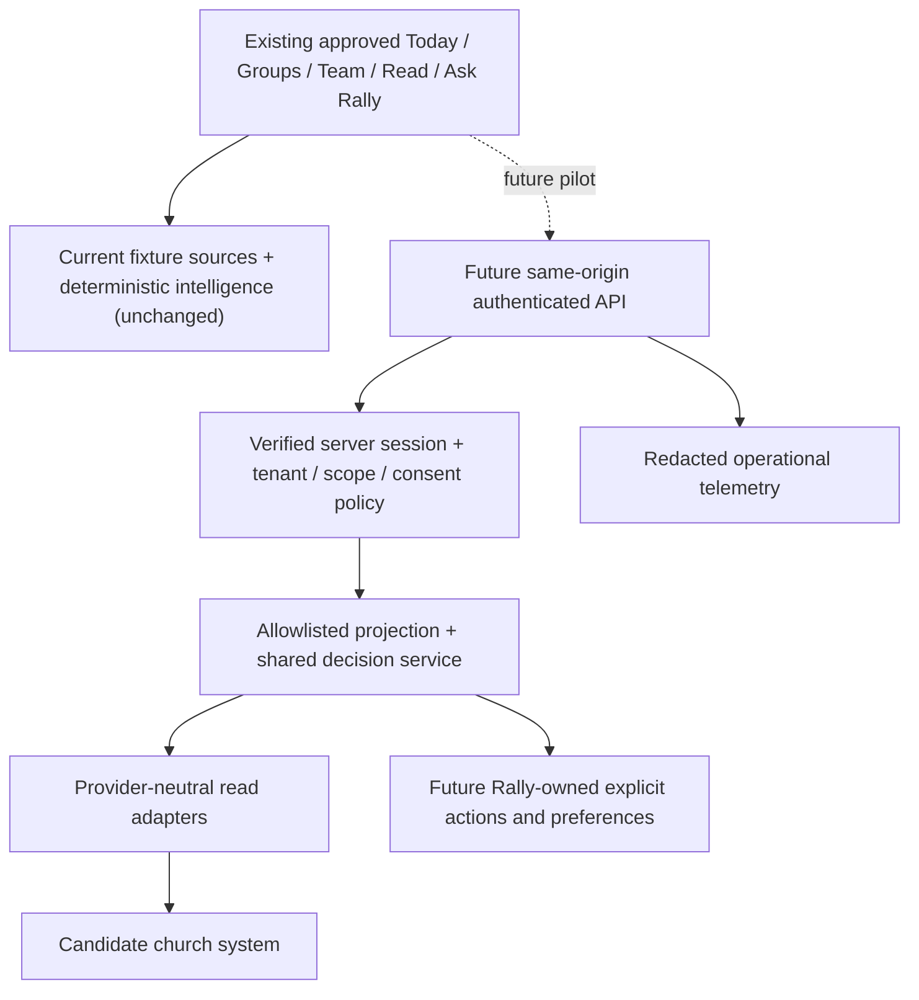

# Rally One | Sprint 9B — Production infrastructure and integration architecture

**Status:** design package for review; not implementation or live-pilot approval.
**Prepared:** 2026-11-23 (Mountain Time).
**Purpose:** help people be known, connected and supported after they join, without turning pastoral care into a surveillance or automated outreach system.

## 0. Baseline, scope and release discipline

This documentation-only branch starts at the verified canonical `rally-one/develop` commit `5aa88c93c3d4cd22902ef98af98c09b74ca436ce`. The architecture is informed by, but does not merge, draft [PR #121](https://github.com/woodrow5087-hue/Citizen-groups/pull/121), reviewed at `90d291f835f6e213620a273569e5c9d2f4e75f26`. That PR reports passing automation, not physical iPhone/VoiceOver or verified Netlify acceptance. Its exact head, approved #119, recovery checkpoints, legacy develop and production main must remain untouched. The branch is deliberately independent; reconcile it against the accepted Sprint 8 head after 9A and then request a small docs-only PR. No PR or deployment is requested by this package.

Reviewed sources at the Sprint 8 head: [architecture](https://github.com/woodrow5087-hue/Citizen-groups/blob/90d291f835f6e213620a273569e5c9d2f4e75f26/engineering/s8-architecture.md), [data contract](https://github.com/woodrow5087-hue/Citizen-groups/blob/90d291f835f6e213620a273569e5c9d2f4e75f26/engineering/s8-data-contracts.md), [intelligence](https://github.com/woodrow5087-hue/Citizen-groups/blob/90d291f835f6e213620a273569e5c9d2f4e75f26/engineering/s8-intelligence.md), [handoff](https://github.com/woodrow5087-hue/Citizen-groups/blob/90d291f835f6e213620a273569e5c9d2f4e75f26/engineering/s8-handoff.md), AGENTS.md, build script, member-context, conversation, action and S7 read-only contracts. [PR #92](https://github.com/woodrow5087-hue/Citizen-groups/pull/92) is a separate historical synthetic integration experiment; inspect and selectively port reviewed contract tests, never merge wholesale. No real records, secrets, account identifiers, church operational information or personal data belong in this public repository.

### Architecture in one diagram

The future path is proposed only. No browser token, raw provider record, unverified local membership, or secret crosses the public boundary. No new framework, database, cloud vendor, deployment target, package, storage key or runtime change is approved here. Existing demo and real-session modes must be physically and logically distinct; never silently fall back to fixture data after a production request fails.

## 9B.1 — Data and relationship architecture

### Model: relationships, not engagement scoring

Use a tenant-scoped relational model as the logical design; an actual database selection, migration and schema are deferred. Every object and relationship is scoped by organization; campus is an organizational subdivision, not automatically a security boundary or a role grant. IDs below are opaque internal IDs; no email/phone matching as primary identity.

| Logical entity | Essential attributes / invariants | Proposed owner |
| --- | --- | --- |
| Organization | orgId, active; partition all requests and data | Church configuration |
| Campus | orgId, campusId, display name, active | Church source after verification |
| Person | orgId, personId, minimal approved display attributes, status | Authoritative church directory; no duplicate demographic database |
| Account link | orgId, personId, identity issuer + subject, link state, verifiedAt | Rally authentication/linkage service |
| Household / household link | orgId, householdId, personId, explicit relationship, effective dates | Church directory; excluded from first pilot |
| Group / group membership | orgId, groupId, personId, scoped role, active/revoked, observedAt | Verified group directory |
| Team / team membership | analogous teamId, personId, role and active/revoked | Verified serving source; later pilot |
| Gathering / shift | orgId, resource ID, authorized parent, startsAt UTC, status, source reference | Verified event/serving source |
| Conversation / membership / message / cursor | retain conversation v1 ownership and reference constraints | Existing Rally contracts; live messaging deferred |
| Explicit action / response | actor, target, state, idempotency key, version, provenance | Owning service; never duplicate provider-authoritative responses |
| Care request / assignment | explicit request, authorized audience, assignment, consent and lifecycle | Restricted human-led care domain; excluded from initial pilot |
| Scripture preference / intention | voluntary user-controlled intention and explicit completion | Rally member; independent of attendance or pastoral status |
| Consent / permission evidence | purpose, scope, policy version, subject, granted/withdrawn at, authorization source | Rally policy service |
| Source reference | provider, tenant, resource kind, external ID, observation and version | Adapter; server-only crosswalk |
| Audit event | actor/tenant pseudonymous IDs, operation, policy decision, timestamp, correlation ID, reason code | Restricted operations/audit store |

Constraints: uniqueness on (org, issuer, subject) and on provider mapping (org, provider, kind, external ID); use composite tenant-aware foreign keys or equivalent enforcement. Membership uniqueness per org/person/group or team; distinct group leader and team leader grants. Historical membership can remain for audit, but revoked access is never valid for current reads. Separate person from login (some people have no account); no automatic merges based on name, shared family email or household. Link conflicts require manual verified resolution. Campus transfer, group revocation, inactive accounts and duplicate IDs are explicit state transitions. Household linkage must not grant authority to view another person's private data. Minors excluded from first pilot; do not infer guardian authority from a household link.

### Ownership and data flow

Preserve `lib/conversation-contracts.cjs` and `lib/action-contracts.cjs` as existing fixture contracts, not production policy. Keep the browser's member context and `lib/member-context-contract.cjs` v1 demonstration semantics unchanged: `mode: demonstration`, identityVerified false. Do not retrofit true identities into it. A separately versioned authenticated projection must have its own reviewed schema and trusted session boundary, mapping only allowed facts to the existing decision service. Avoid a second persistence writer, identity store or recommendation engine.

For each domain record preserve source and observedAt; distinguish confirmed, empty, unknown, unavailable, malformed and stale. Only confirmed facts enter recommendations; known absence is not failure. Authorization failure is restricted at the API boundary, never reported as empty. S7 contract's ready/restricted/unavailable response is a separate minimal view. Its 60-second default freshness window is existing synthetic policy, not a proven live SLA. In a real adapter freshness is measured on authorized successful observation; resource timestamps are not observation timestamps. Re-evaluate authorization and freshness after asynchronous provider reads, before return, because roles/sessions may change during IO.

Member relationship rules: explicit membership, consent and human-requested connections only. No inferred graph from attendance, game scores, giving, browsing, message frequency or friends-of-friends. Do not collect a household roster, full contact directory or prayer notes merely to make a dashboard richer.

**Initial live slice, conditional on separate approval:** signed-in consenting adult sees only their own verified group name and next authorized gathering, or a truthful empty/restricted/unavailable state. No roster, attendance, phone, email, chat, care or writeback.

## 9B.2 — Identity, sessions and account linking

### Authentication choice

Recommend a standards-based identity provider with independently verified support for OIDC authorization code flow and PKCE (S256), a server-side session and same-origin API, subject to procurement and church approval. OAuth provider API access alone does not establish an authenticated Rally identity; do not assume Planning Center provides suitable member OIDC or that all members have developer accounts. Separate Rally user login, provider authorization and verified person linking. Do not make an administrative personal access token a member sign-in mechanism. Reference: [RFC 9700](https://www.rfc-editor.org/rfc/rfc9700.html).

### Proposed journey and controls

1. Member explicitly starts sign-in; server generates one-time state, PKCE verifier/challenge and OIDC nonce where applicable; validate exact redirect allowlist and bind to initiating browser.
2. Server exchanges code; validates issuer, audience, signature/keys, nonce, expiration and applicable token claims. Reject replay, expired state, invalid issuer, redirect, or missing link.
3. Link the identity issuer + subject to an existing church person through an independently verified flow (e.g., reviewed invitation with proof and short expiry); never trust a client-submitted person/org/role or match only on email.
4. Server creates opaque random session ID; rotate at login/privilege change, use Secure, HttpOnly, host-only cookie with appropriate SameSite and Path; no access/refresh tokens in localStorage, URL, HTML, JavaScript or logs. CSRF protection on mutation plus origin validation; separate environments and callback allowlists.
5. On each protected request derive subject/tenant from session, check expiration, account state, current resource membership, consent and action policy. Expiry, revocation or sign-out invalidates session and clears protected client state; recheck on tab visibility, restore and before any protected action.
6. Provider credentials remain server-only, least privilege, encrypted with managed keys, rotated and revocable. Keep provider service account separate from user sessions. MFA and step-up for privileged operations, no shared admin accounts. Define recovery, lost-device and account unlinking processes before real users.

Pilot design defaults (proposals, not implemented): 30-minute idle session and 12-hour absolute session, no persistent remember-me during pilot; immediate server-side revoke on account disable; membership freshness upper bound to be explicitly agreed and tested. A revoked user must never receive private cached content; fail closed when authorization cannot be re-established. Browser cannot prevent an already-authorized person from remembering/screenshotting data; minimize exposed fields.

No identity provider selected. No user creation, OAuth client registration, credential acquisition, live authentication endpoint or migration now.

## 9B.3 — Church-system integration and source ownership

Planning Center is a candidate, not a confirmed Citizen Church provider or licensed scope. Public documentation confirms OAuth/API access and product APIs including Groups, People and Services; it does not establish our tenant permissions, ordinary member login capability, consent, available fields or production integration. Review [developer overview](https://www.planningcenter.com/developers), [authentication](https://api.planningcenteronline.com/docs/overview/authentication), [API products](https://api.planningcenteronline.com/docs/apps), [rate limits](https://api.planningcenteronline.com/docs/overview/rate-limiting).

| Data | Candidate system | Pilot decision |
| --- | --- | --- |
| Organization, member identity link | People / authorized identity source | Verify minimal linking attributes; avoid bulk directory reads |
| Active group membership and group name | Groups | First candidate read-only scope; verify tenant/resource authorization |
| Next gathering | Groups group-specific events | First read-only slice; scheduled future authorized event, title/time only |
| Serving team / schedule | Services or other confirmed source | Defer until verified ownership and separate permission tests |
| Campus / households | Church-configured sources | Verify source and mappings; household excluded initially |
| Giving, attendance, contact lists, private notes | Not needed | Explicitly out of scope |
| Messages, prayer/care, Scripture | Not assumed provider features | No live writes; independently design and approve each later |

Adapter interface (design pseudocode): readAuthorizedGroupView(verifiedSession, requestedResource, clock) -> typed canonical projection. Server supplies organization and subject, never accepts them as authority from request body. Validate upstream organization/subject, active membership, response schema and group/event association; use only allowed title/time/group name and source/observation metadata. Preserve S7's no-roster/no-token/no-care projection. Restrict pagination to allowlisted HTTPS provider origin/path and bounded pages; validate redirects and response size, use timeouts, retry transient idempotent reads with bounded exponential backoff and jitter, honor 429 Retry-After, never retry access denial as transient. Handle cancellation/deletion, stale observations, clock skew, malformed payload, source timeouts, missing membership, duplicate resource and cross-tenant mismatch.

Phase 1: request-driven read-only fetch and short tenant/subject/resource-scoped server cache (only where revocation policy permits); no bulk sync or webhook dependency. No stale private data on outage. Phase 2 only after approval: incremental synchronization with provider-supported cursors or verified webhooks, idempotency, replay protection, tombstones, full reconciliation, dead-letter queue and bounded retry. One owner per field; provider wins on provider-owned fields; explicit Rally-owned preferences never overwritten by sync. No writes in initial pilot. Future writeback must include authorization, confirmation, idempotency key, version/precondition, receipt and audit; never report completion before provider confirms.

Synthetic adapter conformance matrix:
- authorized own group plus future gathering => ready, exact allowlist;
- authorized group with no upcoming event => ready with null nextGathering;
- unknown membership / revoked role / wrong tenant / expired session / wrong subject => restricted and no private payload;
- provider 429/timeout/5xx => unavailable, bounded behavior; no fabricated empty;
- invalid title/timestamp, event attached to other group, redirect/pagination outside provider allowlist, repeated page => reject safely;
- stale or future observation, revocation mid-request, logout mid-request => no private payload;
- extra fields containing fake PII or credentials => omitted by projection; no logs;
- repeated reads do not mutate provider, consent, membership or action state.

Before any credential is created, church owner must confirm provider, subscriptions, designated integration administrator, permitted test tenant/data, exact endpoints and least privileges, provider terms and revocation workflow. Do not use a real church dataset as test fixtures.

## 9B.4 — Authorization, privacy, consent and threat model

Default deny. A role is a resource-specific grant, not a UI label. Enforce in the service and persistence query; browser presentation is never the access-control boundary. A global admin role is not blanket pastoral access. All paths, exports, logs, search, cache and future AI tools must enforce the same rule.

| Subject | Own minimal profile/preferences | Group gathering | Team schedule | Private group roster/chat | Care content |
| --- | --- | --- | --- | --- | --- |
| Guest | Public demo only | No | No | No | No |
| Verified consenting member | Own | Active own membership | Only own active team, later | Not in initial pilot | No by default |
| Group leader | Own | Specific assigned group | No implied access | Later, explicit scoped approval | No implied access |
| Team leader | Own | Only if separately a member | Specific assigned team, later | No implied access | No implied access |
| Authorized pastoral caregiver | Own | Only independent memberships | Only independent memberships | No blanket access | Later, assigned case + purpose/consent |
| Ops administrator | Own / administrative metadata as required | No by default | No by default | No by default | No by default |

The first live slice permits only own group and event; all other rows describe intended limits for later review, not feature grants. Authorization tuple: verified account + tenant + current resource membership/role + purpose + explicit consent where required + allowed operation + freshness. Missing or conflicting input => deny. Avoid object enumeration; consistent restricted response and minimal errors. Deny cross-tenant ID substitution even when resource IDs are valid; filter before pagination and aggregate counts. Revocation clears caches and UI; never reuse server cache across principals. Private responses use Cache-Control: no-store, not public CDN/service-worker caches.

Threats and required tests: forged browser claims, IDOR/tenant escape, stale role, session fixation/replay, CSRF, XSS, malicious provider content, SSRF via pagination, logs/error/analytics exfiltration, credential leaks and supply-chain compromise. Encode text; no provider HTML injection; use security headers and CSP after compatibility test; validate URLs; request/rate limits; dependency/secret scanning; protect environments with least privilege; audit privileged reads and exports. No real secrets, staff names, vulnerabilities tied to deployed settings, personal records or incident details in public GitHub. Sensitive operational runbooks live in a future access-controlled store.

Consent should be understandable, granular, revocable and purpose-limited. Record policy version and timestamps; distinguish sign-in from optional care, messaging and analytics. Provide a church-reviewed withdrawal, access/correction and deletion workflow. Minors, safeguarding, abuse disclosures, confidential pastoral counseling, regulated or legal obligations require independent specialist review before scope expands. Never promise legal confidentiality or automated emergency response.

Proposed retention starting points for adult read-only pilot, pending written church/privacy review: keep provider view only in memory or tightly bounded server cache (no durable raw imports); retain minimal redacted operational events 30 days and security audit records 90 days if justified; delete pilot-only account-link data within 30 days of withdrawal/pilot close absent documented obligation; backup expiry and deletion obligations explicitly agreed. No prayer text, attendance/giving history, message bodies or minors in pilot. Data steward approves schedule, backup treatment, exceptions and incident handling before first record is processed. No production analytics until consent and necessity are decided.

## 9B.5 — Intelligence infrastructure

Keep the existing `RallyIntelligence` application service as the single decision owner; `RallyUnifiedFocus` retains shared eligibility, stable ranking, family deduplication and the two-response-needed-actions cap. Today and Ask Rally consume one versioned decision snapshot. Do not change approved copy, colors, artwork, navigation, game experience or fixture behavior as part of backend work.

Future authenticated inputs are minimum source-backed facts after policy filtering, not raw records. Request path: verified session -> policy -> domain adapters -> canonical projection -> shared deterministic decision -> allowlisted explanation. Each decision records rule version, allowed action ID, reason code, authorized source and freshness status; keep explanations free of private notes. No new competing ranker, external AI, embeddings, model memory or pastoral inference. A future AI interface, if separately approved, may explain authorized facts or offer user-requested help, never be authority for access, completion or urgency; tool authorization and privacy must be enforced independently, not through prompts. Prompt injection and output leakage tests required before any model sees data.

Test visitor/member/volunteer/authorized leader, denied leader after role revoke, missing/zero/stale unread, conflicting membership, unavailable provider, explicit completion, defer/resume and repeated deterministic result. Today and Ask Rally must agree about eligibility and reason. No inferred need from absence, attendance, response delays, games, donations or reading streaks. Care remains explicitly requested, human-assigned and human-reviewed; no risk/spiritual scores or autonomous contacts. Reading/game data remains independent of pastoral priority. First pilot intelligence: at most explain the verified next gathering, without introducing care or engagement predictions.

## 9B.6 — Operational resilience and environment design

| Environment | Data and credentials | Release policy |
| --- | --- | --- |
| Local/unit/CI | Fictional fixtures only; no external API | deterministic tests; no secrets |
| Existing Netlify previews | Fictional demo only | exact commit provenance, no real auth/provider keys |
| Future isolated staging | synthetic or separately approved test tenant; independent keys | access-controlled, no production secrets |
| Future adult read-only pilot | minimal consented data; independent credentials | explicit owner/security/data-steward approval and kill switch |
| Production | not authorized | independently approved release, rollback and incident process |

Do not set real credentials in deploy-preview or untrusted PR builds. Separate accounts or projects, secrets, databases, identity callbacks and audit streams. If existing site auto-builds a new branch, it is not a verified deployment or authorization; do not alter Netlify settings to manufacture one. At Sprint 8 head the build treats branch-deploy and deploy-preview differently: branch-deploy adds default Today board but only deploy-preview enables the Rally One default experience. Record actual context, head SHA, URL and experience when 9A is performed; do not assume a branch deployment equals PR acceptance.

### Reliability proposals

- Define objective metrics without member content: availability/error rate, upstream latency, rate-limit count, stale projection count, authorized/unavailable totals, cache age and deployment SHA. Log random request IDs, coarse error category and sanitized build version; no tokens, names, messages or raw payload. Security audit separately restricted. Avoid persistent tracking identifiers in general analytics.
- Initial candidate service targets (validate during synthetic staging): 99.5% availability during agreed pilot window, p95 cached authorized API <=500ms, uncached <=2s subject to provider; hard upstream deadline 3s and total request deadline 5s; measure actual baseline before committing to service-level promises. Alert on recurring failures, 429 spikes, freshness breaches and unauthorized cross-tenant test failures, not member behavior.
- Provider outage: restrict when membership cannot be proven; otherwise truthful unavailable for failed authorized read; no stale private facts or fixture fallback. Show retry after bounded delay, never expose raw error. Circuit breaker and bounded concurrency avoid cascades. Retry reads only if still authorized. A revoked or signed-out subject cannot use queued operations.
- Backups: initial read-only architecture should minimize durable data; for necessary account links/consent/audit store, encrypted backups and tested restoration to isolated environment; candidate RPO 24h/RTO 4h for pilot data, subject to feasibility and written approval. Revocation, deletion and consent changes must be reconciled after restore before traffic. No backups of raw provider payloads.
- Incident response: disable live integration with independent server-side flag; revoke affected sessions and provider credentials, contain and preserve minimal approved evidence; notify designated security/privacy owner; evaluate affected records and applicable notification obligations; document correction and require explicit re-enable. Avoid exposing incident details publicly.
- Rollback: maintain immutable known-good code plus compatible schema; rollback app/service independently; deny access on incompatible schema. Migration plans must be dry-run, forward/backward compatible or have approved restore; no destructive auto-migrations on start. Test disable and restore before pilot. Never reset protected Git refs or use production to troubleshoot preview.

Proposed backend selection scorecard: security and tenant isolation (25%), identity/session/secret controls (20%), operational ownership and recovery (15%), integration fit (15%), total cost/limits (10%), portability/export and migration (10%), developer usability (5%). Compare managed relational + server runtime, integrated managed backend, and existing church-approved platform against identical synthetic tests. No vendor selection until IT ownership, legal/privacy, budget and account access requirements are known.

## 9B.7 — Developer handoff, verification and next milestones

### Implementation order (each item requires its own review gate)

| Stage | Small deliverable | Exit evidence |
| --- | --- | --- |
| 9A | Exact Sprint 8 Netlify provenance + physical iPhone Safari/VoiceOver | Same head SHA and build context, device record and manual checks; report remaining accessibility, rights, security separately |
| 9B review | This architecture package | Owner review; reconcile against accepted 8/9A; docs-only diff, no app mutation |
| 9C.1 | Server-only synthetic adapter conformance harness | Matrix above, no network calls or secrets, existing S7 contract extended rather than duplicated |
| 9C.2 | Verified-session and scoped policy interface using synthetic identities | Fail-closed tests, no browser-auth claims, post-read revocation check, no public bundle |
| 9C.3 | Authenticated projection proposal and intelligence seam (synthetic) | Versioned schema, strict allowlist, existing deterministic service; fixtures unchanged |
| 9C.4 | Isolated synthetic staging prototype + operational drills | Reproducible build, redacted telemetry, rollback/disable and recovery drill |
| 9D | Real identity and provider test-tenant proof, separately authorized | Church/admin agreement, threat review, consent, exact API permissions, tests, no production member data |
| 9E | Small adult opt-in read-only pilot, separately authorized | Named owners, scoped data, privacy/retention, tested incident and revocation, rights/editorial and accessibility approval |
| Later | Serving, messaging and care | Separate business case, owner, scoped security/consent, independent tests; no automatic expansion |

Do not merge #92, change #121, or implement any stages above from this branch before the 9A and 9B review gates. In future implementation start from accepted canonical base, record exact head and protected refs, use small reviewable PRs, preserve approved visual reference. Use Node >=22.12 and existing Sprint 8 handoff commands, all unit/game/browser/accessibility suites, immutable #119 pixel comparison (zero threshold), physical device gate. Ensure server-only contracts, engineering notes and credentials excluded from dist. Current build copies all docs and assets; internal docs stay in engineering, and public repo contains only non-sensitive architecture. Add public artifact allowlist/secrets check, synthetic authorization tests and version compatibility checks before live work.

### Open decisions and accountable owners (roles, not appointments)

| Decision | Proposed accountable reviewer | Evidence needed |
| --- | --- | --- |
| Confirm church system, API owner and permitted pilot scope | Church product owner + integration administrator | Written confirmation, supported endpoints/licensing |
| Choose identity provider and linking mechanism | Church IT/security owner | Threat model, identity capability, account lifecycle |
| Approve data minimization, minors exclusion, consent, retention | Church data steward/privacy reviewer | Documented policies and participant consent |
| Approve backend vendor and operating budget | Technical owner + church leadership | Scorecard, realistic load/cost, exit plan |
| Define pilot participants, support channel, incident owner | Ministry owner + operations/security | Named responsible people and disable procedure |
| Approve design and physical accessibility | Product owner + independent reviewer | Exact-head device acceptance, rights/editorial review |
| Approve deployment | Authorized release owner | Independent security review, test matrix, rollback proof |

Success criteria for first live pilot: consenting adults can securely see their own verified next group gathering; restricted users see no protected facts; unavailable sources are handled truthfully; support can disable the integration without disturbing approved demo; participants report whether the experience makes connection easier. No engagement scores, forced actions or broad directory import. Collect only consented minimal feedback, not behavioral tracking.

### Explicit decision log

- Accepted as design direction: retain existing front end and contracts; provider-neutral boundary; one source owner per fact; human-led care; fail-closed access; read-only narrow first slice.
- Proposed, awaiting technical/church review: logical relational model, OIDC/session approach, freshness/retention/SLO values, backend scorecard and pilot design.
- Deferred: vendor selection, actual DB/schema, live authentication, API credentials, provider writeback, real messaging and care, household/minor functionality, external AI, production release.
- Verification for this documentation sprint: repository source and PR inspection only; verify the committed docs-only diff and protected refs. No app/browser tests, physical-device tests, security certification or live deployment are claimed for this document. Implementation tests remain mandatory.

**End state:** design ready for review, 9A still blocked on deployment/device acceptance, no runtime or live-data authorization.
