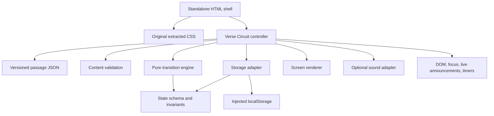
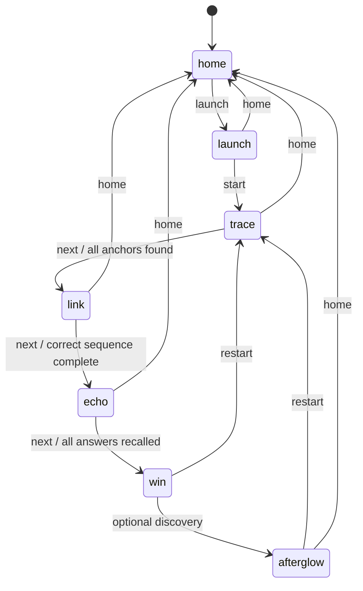

# Verse Circuit architecture

The application retains the approved presentation and replaces the single-file prototype's shared mutable rules with explicit module boundaries. This is one game's foundation, not a speculative universal engine. Native browser ES modules work with the existing static build; `verseplay/package.json` gives the isolated Node tests the same module semantics without changing the older application's CommonJS tooling.

## Module ownership



`circuit-engine.js` receives only gameplay state, an action, and already validated content. It does not read `window`, `document`, storage, time, audio, or CSS. Given the same inputs, it returns the same result. The storage adapter accepts the storage object from the controller, so tests can model missing storage, exceptions, malformed JSON, and interrupted sessions without a browser.

The renderer turns state and content into screen markup. It does not award progress, persist state, or select the next stage. The controller owns initialization, delegated events, the current in-memory state, saving, rendering, navigation focus, dialogs, and execution of effects. The sound adapter preserves the prototype's oscillator envelope and respects a separately owned sound preference. Audio failures cannot prevent a move.

## Public gameplay contract

```js
import {createInitialState, transition} from './core/circuit-engine.js';
import {validateState} from './core/state-schema.js';

const initial = createInitialState(content);
const result = transition(initial, {type: 'launch'}, content);
// { state, accepted: true, effects: [...] }
```

A rejected action returns `accepted: false`, a machine-readable `reason`, the original state, and no effects. An incorrect but available answer is an accepted attempt: it increments mistakes and returns corrective feedback without granting progress. A repeated selection, unknown identifier, premature stage transition, wrong-stage action, or attempt to access Afterglow before completion is rejected.

Actions are `home`, `launch`, `start`, `restart`, `next`, `trace`, `link`, `echo`, `hint`, `resetlink`, `resetecho`, and `afterglow`. Selection actions carry a stable content identifier as `value`, never a DOM node, position, or translated display string. Concept dialogs and sound toggling are interface concerns outside this action API.

The engine returns plain effect descriptions: `render`, `sound`, `announce`, `feedback`, and `incorrect`. The controller interprets those descriptions using the original sound frequencies, status text, animation classes, and timings. No effect executes from inside the reducer. This boundary makes rules testable without replacing the approved tactile feedback.

## State machine and invariants



Returning to the arcade retains existing progress, matching the prototype. Starting from the introduction creates a new round; replay also clears progress, hints, mistakes, and completion while preserving the sound preference. TRACE permits the three anchors in any order. LINK and ECHO accept only the next item in their content sequences. Undo removes one selection from the current stage; hints refer only to its next unresolved item. A hint after completing a stage safely does nothing.

State schema version 1 contains `schemaVersion`, `contentId`, `contentVersion`, `screen`, `trace`, `link`, `echo`, `mistakes`, `hints`, and `completed`. It contains no sound setting, markup, animation flags, or DOM references. Arrays contain unique stable IDs. LINK and ECHO must be exact prefixes of their correct sequences. Any later-stage progress requires completed prior stages. Victory and Afterglow require all three stages and the explicit completion flag. TRACE, LINK, and ECHO reject impossible later-stage or completed combinations. Counters must be nonnegative safe integers.

These invariants are checked during restoration and by the transition boundary. Array length alone cannot create a victory state. Future schema changes require a deliberate migration and corresponding tests rather than silently accepting an older object's shape.

## Storage and recovery

Progress is stored at `verseplay:verse-circuit:<content-id>` and sound preferences at `verseplay:preferences:v1`. Progress is versioned and tied to both the passage ID and content version. A load must validate JSON shape, supported schema, content identity/version, selection IDs, sequence prefixes, and stage reachability before rendering gameplay from it. Preferences use a separate record so sound changes cannot grant progress and a game reset need not erase preferences.

The adapter supports the original `verse-circuit-design-v1` format as a specific legacy migration. Valid legacy phrase strings and numeric positions map to the current stable IDs; migration must satisfy the same state invariants as a new save. It does not invent missing selections to justify a completed flag. The original sample's sound value migrates separately when valid.

Missing storage starts a normal fresh game. Denied storage access or write failure allows the current session to continue in memory. Corrupt JSON, unsupported versions, changed content, and impossible progress reset only this game's affected progress with an explanatory notice; unrelated Rally One keys are never cleared. Read/write exceptions are caught by the storage boundary. The controller handles failure to obtain `window.localStorage` itself.

Recovery notices are exceptional player-visible reliability behavior. The controller presents them accessibly using existing visual conventions. A content fetch or validation failure produces a usable retry screen and leaves existing saved progress untouched. Exact messages and exercised cases are recorded in [QA](QA.md).

## Scripture content lifecycle

The content model has its own schema version plus a stable passage ID and content version. It records the exact source passage, reference, translation, source URL and verification date, editorial review status and attribution, and rights information. Phrase IDs, segment IDs, correct sequences, missing-word answer IDs, distractors, option order, hint text, and token streams describe the existing three-stage puzzle without embedding the passage in rule handlers.

The validator reconstructs the full verse independently from LINK segments, TRACE tokens, and ECHO tokens. Each must exactly match the vetted source text, including punctuation and capitalization. IDs must be unique and references/sequences valid. Metadata describes real evidence; it must never imply a church review or approval that has not occurred. Afterglow remains optional and explicitly illustrative until actual editorial approval.

To add a passage, follow [CONTENT_GUIDE.md](content/CONTENT_GUIDE.md): obtain a vetted source with usable rights, assign stable IDs, preserve exact text in every reconstruction, provide reviewed puzzle selections and appropriate distractors, record honest editorial status, validate the file, add meaningful content/engine/browser fixtures, and review its actual mobile layout. This sprint ships one passage; another file is not automatically exposed in a new passage picker. Any selection UI is separate product work.

Bump the content version when gameplay-affecting text, IDs, answers, or ordering changes. Preserve IDs only when they still identify the same semantic item. If compatibility cannot be proven, reset that passage's progress with an explanation rather than guessing a migration.

## Visual preservation and accessibility

The immutable [`reference/verse-circuit-original.html`](reference/verse-circuit-original.html) is the approved comparison fixture. CSS tokens, fonts, gradients, geometric SVGs, textures, spacing, layouts, stage transitions, completion effects, and visible sample copy are preserved. The stylesheet was extracted without an intentional design edit. The static page retains its approved shell; passage text now comes from content data.

The browser suite reaches matching states through real buttons and captures both versions at 320, 375, 390, and 430-pixel widths. It waits for fonts and normalizes animation capture so timing differences are not mistaken for a design change. It also exercises reduced motion separately. [QA](QA.md) is the evidence ledger for actual comparisons and any remaining findings; pixel parity with zero non-antialias changes is strong evidence for that tested viewport/state/browser, not a promise about every device.

Deliberate accessibility repairs preserve the visual design: keyboard activation restores a useful replacement focus target after a screen fragment is rendered, and a concept modal makes background gameplay/audio controls inert while trapping focus and restoring its opener on close. The stage meter has an explicit image role for its label, and Afterglow headings expose level 2 while keeping the original h3 styling. Stage navigation still places focus on the new heading; feedback uses status/live announcements. Existing reduced-motion CSS remains in force. Any further visible accessibility change must be documented and reviewed against the design freeze rather than silently restyling the game.

## Safe extension and QA expectations

Change a rule in the engine and cover the user-relevant boundary, including an illegal action. Change state invariants or persistence only with invalid-save, migration, and reload coverage. Change content only after exact reconstruction and rights/editorial validation. Change the renderer/controller with a real keyboard/touch browser journey and matched reference screenshots. Keep optional browser effects outside the engine, and do not add hidden cross-game state dependencies.

Before a PR is considered complete, run the isolated unit suite, repository tests, static build, Verse Circuit browser regressions, and relevant existing repository browser checks. Record executed commands, actual pass/fail counts, baseline failures, browser/font environment, and untested platforms in [QA](QA.md). Do not claim checks that were unavailable. Do not fix unrelated member experiences inside this sprint.

## Architectural decisions and deferred work

- Use native ES modules and a static copy build: enough separation for independent testing without introducing a framework or changing application tooling.
- Keep a game-specific reducer: shared content/storage boundaries can support later games, but TRACE/LINK/ECHO rules remain Verse Circuit's responsibility.
- Treat content and saved progress as validated input: invalid state cannot manufacture completion, and version changes have an explicit recovery boundary.
- Separate preferences from progress: optional sound survives replay and does not participate in game eligibility.
- Retain original styling and the original fixture: visual parity is reviewable and reproducible, rather than relying on memory.
- Keep editorial verification honest: source checks and public-domain rights do not constitute theological or church approval.

Deferred work includes real-device Safari QA, offline/font packaging, editorial approval and publishing controls, cloud/member synchronization, analytics, authentication, multiplayer, content authoring tools, wider game support, and production deployment. Each needs a separate scope and evidence. The Git baseline and approved-branch preview constraints are documented in [BASELINE_AUDIT.md](BASELINE_AUDIT.md).
